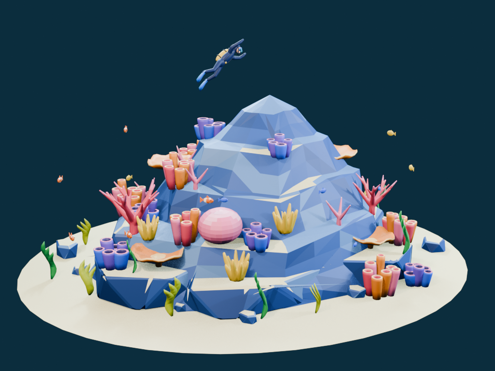
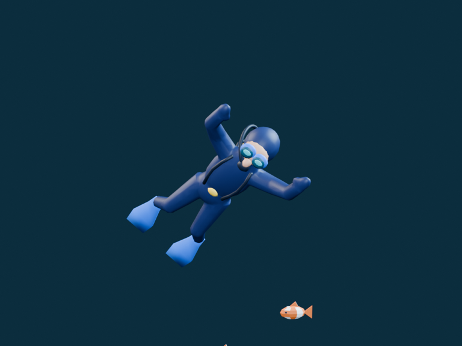
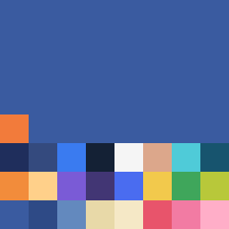

# Step 04 總結 — 完整模型

對應 roadmap:[roadmap/04-detailed-model.md](../roadmap/04-detailed-model.md)
狀態:完成(2026-10-16 建模完成,2026-10-18 commit `39fc7c9`);修正前快照保存在 `blender/revisions/detail_before_step05/`

## 代表結果



hero 視角:同一個單峰山體,換上細分切面、沙色平台、有機珊瑚、帶狀海草與三盞 softbox 的 Eevee 打光。

| 潛水員近照 | 64×64 色票(放大 4 倍) |
|---|---|
|  |  |

左:融合成連續潛水衣的身體,背帶貼著表面走,面鏡、氣瓶、呼吸管、蛙鞋是獨立零件。
右:全場景唯一的貼圖,8×8 格、25 個色塊,每個面的 UV 指到一格的中心。

代表程式碼:有機融合三部曲([detail_geometry.py](../blender/scripts/detail_geometry.py) `fuse`)

```python
mod = obj.modifiers.new('OrganicUnion', 'REMESH')
mod.mode, mod.voxel_size = 'VOXEL', voxel
bpy.ops.object.modifier_apply(modifier=mod.name)
mod = obj.modifiers.new('JointRelax', 'SMOOTH')
mod.factor, mod.iterations = 0.65, 3
bpy.ops.object.modifier_apply(modifier=mod.name)
count = sum(len(p.vertices) - 2 for p in obj.data.polygons)
mod = obj.modifiers.new('WebBudget', 'DECIMATE')
mod.ratio = min(1.0, triangles / max(count, 1))   # 預算是輸入,不是結果
bpy.ops.object.modifier_apply(modifier=mod.name)
```

代表資料:[build_report.json](../blender/renders/final/build_report.json) 的分組面數

```json
{
  "mesh_objects": 91, "unique_meshes": 26,
  "triangles": 49420, "unique_triangles": 16690,
  "groups": {
    "coral": {"objects": 35, "triangles": 32388, "unique_triangles": 7098},
    "diver": {"objects": 5,  "triangles": 5340,  "unique_triangles": 5180},
    "kelp":  {"objects": 16, "triangles": 3648,  "unique_triangles": 456},
    "fish":  {"objects": 15, "triangles": 2460,  "unique_triangles": 492}
  },
  "materials": 1,
  "checks": "budget, single summit, hierarchy, shared variants and palette UVs passed"
}
```

## 這一步做了什麼

1. 從 `01_graybox.py` 分出 `02_detail.py`(入口、參數、擺放、render、報告)與 `detail_geometry.py`(每個零件的細模 builder、色票、岩面 / 沙地細修)。
2. 保留核准灰模的山體、階層、命名、origin;**替換所有佔位 primitive** 為有機細模:
   - 分枝珊瑚:管狀分枝 → 體素融合成連續表面 → 平滑 → decimate 到預算。
   - 管狀珊瑚:有厚度、圓唇、內壁、深色內腔。
   - 盤珊瑚:波浪邊;腦珊瑚:面片顏色暗示溝紋;小叢珊瑚:融合的小管。
   - 海草:三片帶狀曲面;魚:尾鰭、背鰭、眼睛、小丑魚白色條紋。
   - 潛水員:潛水衣融合成連續肢體,再貼上背帶、面鏡、黃色氣瓶、呼吸管、蛙鞋。
3. 岩面加細分與局部起伏、坡腳倒角、沙色平台;沙地細分加微起伏。
4. 用程式直接寫出一張 64×64 sRGB 色票 PNG,打包進 `.blend`,全場景一個 Principled BSDF。
5. 建立三盞 area softbox、藍色 world、Eevee 64 samples、AgX,render 六視角 + 三張潛水員近照 + contact sheet。
6. 腳本結尾用 `assert` 檢查預算、單峰、階層、共用 mesh、palette UV,寫出 `build_report.json`。

## 產出

| 檔案 | 內容 |
|---|---|
| `blender/scripts/02_detail.py` | 入口,從空場景重建(`--preview` 只 render hero) |
| `blender/scripts/detail_geometry.py` | 零件 builder、`fuse`、`refine_rock`、`refine_sand`、`build_palette` |
| `blender/scenes/02_detail.blend` | 細模場景,色票已 packed |
| `blender/textures/reef_palette.png` | 64×64 色票(338 bytes) |
| `blender/renders/final/*.png` | hero、六視角、diver_front / back / side、contact_sheet |
| `blender/renders/final/build_report.json` | 分組面數 |
| `blender/renders/final/metrics.json` | 獨立 inspector,issues 為空 |
| `blender/renders/final/modeling_contract.json` | 本階段的 critical / budgets / style / uncertainties |
| `blender/renders/final/final_report.md`(Step 04 版本保存在 revisions) | 人類可讀總結 |

## 結果數字

| 群組 | 物件 | 場景 tri | unique tri | 計畫值(場景) |
|---|---:|---:|---:|---:|
| 沙地 | 1 | 768 | 768 | 800 |
| 主山體 + 坡腳岩 | 7 | 2,272 | 2,272 | 10,500 |
| 散石 | 12 | 2,544 | 424 | 2,400 |
| 珊瑚 | 35 | 32,388 | 7,098 | ≈ 27,400 |
| 海草 | 16 | 3,648 | 456 | 3,200 |
| 潛水員 | 5 | 5,340 | 5,180 | 4,000 |
| 魚 | 15 | 2,460 | 492 | 5,250 |
| **合計** | **91** | **49,420** | **16,690** | ≈ 54,000 |

硬上限:場景 < 100k、unique < 40k、每種魚 ≤ 400 tri(實際 164)。全部通過。
材質 1、貼圖 1(64×64)、unique meshes 26,與灰模完全相同。
整個建構加九張 render 約 5.5 秒。

## 技術說明

### `Geo` 類別:用 Python 直接組 mesh

`detail_geometry.py` 不用 `bpy.ops` 加 primitive,而是自己維護 `vertices / faces / colors` 三個 list:

- `loft(rings)`:把一串環連成管面,可選封口。
- `tube(points, radii)`:沿折線算切線,建局部座標系後 loft。
- `ellipsoid(center, scale)`:經緯球。
- `face(indices, color)`:每個面同時記錄色票名稱,最後變成 `material_index`。

`mesh()` 用 `from_pydata` 一次建好,再用 bmesh `recalc_face_normals` 統一法線。這比 ops 快很多,也完全不依賴 context。

### `fuse`:有機融合三部曲

```
REMESH (VOXEL, voxel_size) → SMOOTH (factor 0.65, 3 次) → DECIMATE (ratio = 預算 / 目前面數)
```

把獨立的管子、球融合成一個連續閉合表面,接合處不會有穿插的面。voxel 大小依零件尺度調(分枝珊瑚 `h × 0.014`,潛水衣 0.0045,小叢 0.007)。decimate 的 ratio 用「目標 tri / 實際 tri」算出來,所以預算是輸入而不是結果。

### 色票:手寫 PNG + Closest 取樣

- `build_palette` 直接用 `zlib` + `struct` 寫 PNG(IHDR / IDAT / IEND),不依賴 PIL。
- 8×8 格、每格 8 px,25 個 swatch,其餘填岩石藍。
- 每個 polygon 的 UV 全部指到格子中心 `((i % 8) + 0.5) / 8`,貼圖 interpolation 設 `Closest`,所以不會混色。
- 一個 material、一張 packed image;所有 mesh 的 `material_index` 歸零,顏色完全靠 UV。

### 岩面與沙地

- 主山體:三角化 → `subdivide_edges` 1 次 → 新頂點在 z ∈ (0.08, 1.56) 內做 ±1.4 cm 抖動,峰頂與底圈不動。
- 坡腳岩、散石:`bevel` 邊 1.5 cm,得到柔和的切面。
- 面的顏色依法線與位置決定:朝上且在特定路徑上的面 → 沙色平台;其餘依 `sin` 雜訊分 rock / rock_light / rock_dark。
- 沙地:細分 3 次,邊緣淡出的微起伏。

### 潛水員

- 身體用 ellipsoid + tube 組,再 `fuse` 成連續潛水衣。
- 背帶用 `BVHTree.ray_cast` 從下往上打到潛水衣表面,沿表面貼出;有 `assert` 確保每一點都命中。
- 呼吸管是 Bézier 曲線取 17 點的 tube。
- 氣瓶、面鏡、蛙鞋是獨立 mesh,parent 到 `Diver` empty;左右蛙鞋共用 mesh。

### Render

Eevee、1024×768、64 samples、固定 2 threads;Key 暖色 / Fill 冷色 / Rim 冷色三盞 DISK area light,world 深藍。AgX Medium High Contrast。contact sheet 用 numpy 把六張縮到 512×384 拼成 3×2。

### 自我檢查

腳本末尾的 `assert` 把 Definition of Done 變成程式:預算、1 個材質、每個 mesh 恰好 1 個 UV layer、階層 parent 正確、每個 prefix 只有 1 個 mesh data、峰頂唯一且高 1.65 m、魚 ≤ 400 tri。任一失敗 `--python-exit-code 1` 會讓 Blender 非零退出。

## Takeaway

- **預算當輸入,不當結果**:`fuse` 的 decimate ratio 由目標面數反推,所以總面數穩定在預算內,不用事後砍。
- **色票 UV 是本專案材質工作的全部**。沒有 bake、沒有 node tree 複雜度、沒有 glTF 不支援的節點;Step 06 export 幾乎沒有材質風險。
- **用 Python 直接組 mesh 比 `bpy.ops` 可靠也快很多**,而且 random stream 可以每個零件各自固定 seed(201 / 202 / 301 / 302 / 401 / 710 / 711),改一個零件不影響其他零件。
- **把 DoD 寫成 `assert`**,重跑腳本就是跑測試。這在 Step 05 迭代時省掉大量人工核對。
- 預算分配與計畫有出入(珊瑚與潛水員超出計畫,山體與魚遠低於計畫),但總量在硬上限內。計畫值是估算,硬上限才是 gate。
- 這一步**留下了接合問題**(管根懸空、管口被埋、珊瑚互穿、沙地法線朝下),render 看起來正常,但幾何量測才抓得到。這就是 Step 05 存在的原因。
