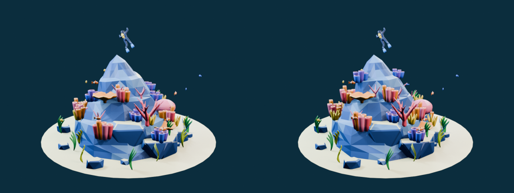
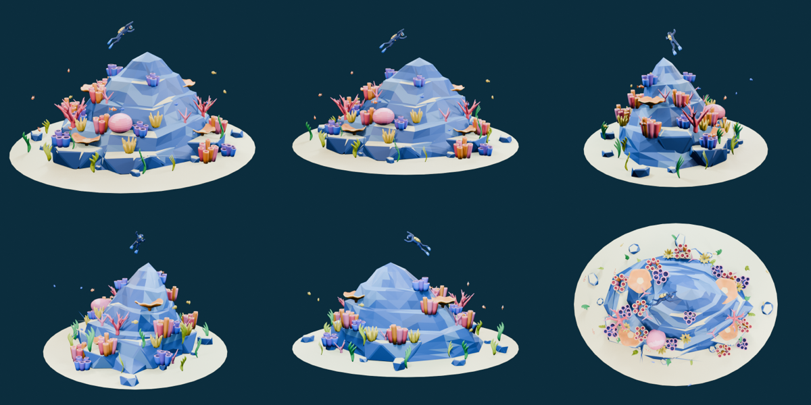

# Step 05 總結 — Render 檢查與修正

對應 roadmap:[roadmap/05-render-and-inspect.md](../roadmap/05-render-and-inspect.md)
狀態:完成(2026-10-19,commit `7ae67a5`)

## 代表結果



左視角,同相機同打光:左邊是 Step 04 基準,右邊是修正後。差異刻意很小,因為山體、潛水員、魚都沒動,只有珊瑚與海草的擺放變了。看前景左側的橘色管叢:修正前整叢跨出平台邊緣,外側幾根懸空;修正後整叢以最弱支撐的那根為準坐進岩面,另外兩叢管珊瑚移到上層平台。



最終六視角。這組影像的 SHA-256 與來源腳本、`.blend` 的 hash 一起記錄在 `render_manifest.json`。

代表程式碼:每根管子各自量支撐,整叢只動 transform([02_detail.py](../blender/scripts/02_detail.py) `seat_tube_cluster`)

```python
for component in connected_components(bm):          # 一根管子 = 一個 component
    low  = min(v.co.z for v in component)
    high = max(v.co.z for v in component)
    roots = [transform @ v.co for v in component if v.co.z < low + .0001]
    lips.extend(transform @ v.co for v in component if v.co.z > high - .0001)
    supports.append(max(ground_z(obj.location.x + p.x, obj.location.y + p.y) - p.z for p in roots))
obj.location.z = min(supports) - .003               # 以最弱支撐的那根為準,淺埋 3 mm
clearance = min(obj.location.z + p.z - ground_z(...) for p in lips)
assert clearance >= .045, (obj.name, 'buried tube opening', clearance)
```

代表資料:[iteration_review.json](../blender/renders/final/iteration_review.json) 的修正前後

```json
{
  "before": {"unsupported_components": 36, "buried_tube_openings": 17, "decoration_surface_intersections": 11},
  "after":  {"unsupported_components": 0,  "buried_tube_openings": 0,  "decoration_surface_intersections": 0},
  "invariant_results": {
    "names_preserved": true, "parenting_preserved": true,
    "non_sand_geometry_and_uvs_preserved": true, "shared_mesh_assignments_preserved": true,
    "non_decoration_transforms_preserved": true, "aggregate_bounds_within_1cm_preserved": true
  },
  "decision": "retain_repair"
}
```

## 這一步做了什麼

1. 先把 Step 04 的來源、場景、色票、報告、影像整包複製到 `blender/revisions/detail_before_step05/` 當基準。
2. 對基準做視覺 critique(`critique.json`):輪廓、比例、材質、零件齊全都通過;**地面接觸 fail**;法線與互穿「不確定,需幾何審核」。
3. 寫 [blender/scripts/03_inspect.py](../blender/scripts/03_inspect.py):唯讀審核腳本,載入基準與最終兩個 `.blend`,量根部接觸、管口露出、互穿、法線、transform、origin、unused data,並做回歸比對。
4. 依量測結果修 `02_detail.py` 與 `detail_geometry.py`:
   - 先細修岩面與沙地,**再**擺放珊瑚與海草(原本順序相反)。
   - `ground_z` 改用整個地形的 `BVHTree` 一次投射,不再對每個物件分別 ray_cast,也拿掉 z=0 的下限。
   - 新增 `seat_tube_cluster`:管叢的每根管子各自量「最低頂點」與「最高頂點」,整叢以最弱支撐那根為準下沉,再淺埋 3 mm,並 `assert` 所有管口高出當地岩面 ≥ 4.5 cm。
   - 新增 `DECORATION_ADJUSTMENTS`:18 個物件的 `(dx, dy, yaw)` 固定微調表,用於移到附近平台或避開互穿。
   - `refine_sand` 明確把所有 `normal.z < 0` 的面翻正。
5. 從空場景重建、重 render 九張、跑 inspector 與 `03_inspect.py`,寫 `iteration_review.json`,決策 `retain_repair`。

## 產出

| 檔案 | 內容 |
|---|---|
| `blender/scripts/03_inspect.py` | 唯讀審核 + 回歸比對 |
| `blender/renders/final/technical_checks.json` | pass / errors、每 mesh 拓撲、171 個根部單元、互穿、transform、origin、unused |
| `blender/renders/final/scene_comparison.json` | 基準 vs 最終:名稱、父子、幾何 / UV hash、材質、transform、邊界 |
| `blender/renders/final/render_manifest.json` | 來源、場景、九張影像的 SHA-256,render 設定 |
| `blender/renders/final/placement_review.json` | 每個管叢的調整值、最終 z、管口淨空 |
| `blender/renders/final/iteration_review.json` | before / after ledger 與決策 |
| `blender/renders/final/final_report.md`、`work_state.md` | 人類可讀總結與狀態 |
| `blender/revisions/detail_before_step05/` | 修正前完整快照 |

## 結果數字

| 檢查 | 修正前 | 最終 |
|---|---:|---:|
| 根部未接觸的單元(gap > 1 mm) | 36 | 0 / 171 |
| 管口低於岩面 + 4.5 cm 的單元 | 17 | 0 / 104 |
| 珊瑚 / 海草 BVH 表面相交配對 | 11 | 0 |
| 沙地朝下的面 | 有 | 0 |
| 場景 / unique triangles | 49,420 / 16,690 | 不變 |
| mesh objects / unique meshes | 91 / 26 | 不變 |
| 主峰 / 最高珊瑚 | 1.65 m / 1.394 m | 不變(淨空 0.256 m) |
| 整體邊界 | — | X / Y / 頂部不變,底部降 5.1 mm(容差 1 cm) |
| 擺放改變的物件 | — | 51 個(全部是珊瑚與海草) |

`technical_checks.json`:`pass: true, errors: []`。inspector `metrics.json`:hard gate 通過,issues 為空。

## 技術說明

### 為什麼 Step 04 會留下接合問題

- 擺放發生在岩面細修之前,細修後的表面與擺放時的表面不同。
- 管叢只用「叢中心」一點取地面高度;叢直徑 0.2 m 跨在平台邊緣時,外圍的管子不是懸空就是被埋。
- `ground_z` 原本有 `heights = [0.0]` 的下限,在沙地微起伏處會把根部抬離地面。
- 沙地是開放表面,`recalc_face_normals` 對開放面沒有「外側」可依據,結果法線朝下。

### 量測方法(`contact_report`)

- 對每個珊瑚 / 海草物件,用 bmesh 拆 connected components(一根管子、一片海草都是一個 component),共 171 個。
- 每個 component 取**最低 2 mm 帶**的頂點(融合後的底部不是平面,只取一個最低點會誤判),world 座標往下投射到地形,`min gap ≤ 1 mm` 視為接觸。
- 管狀珊瑚另取最高頂點,量管口距地面高度,門檻 4.5 cm。
- 互穿用 `BVHTree.overlap` 兩兩比對所有裝飾物件,回傳三角形配對數。
- 自述限制:這些是有界檢查,不是「場景中無任何自相交」的證明;根部刻意淺埋岩石與潛水員裝備接合排除在外。

### 回歸比對(`snapshot` + `scene_comparison`)

每個物件記錄 parent、world matrix、mesh 名、材質、以及「頂點 + 面 + UV + smooth flag」的 SHA-256。比對項目:

- 名稱、父子、共用 mesh、材質指派:必須完全相同。
- 非沙地的幾何與 UV hash:必須相同(證明只改擺放沒改 mesh)。
- 沙地頂點位置 hash 相同,但允許繞序改變。
- 非珊瑚 / 海草的 transform:必須相同(山體、潛水員、魚未動)。
- 整體 bound box 差異 < 1 cm。

任一項失敗 → `errors` 非空 → `RuntimeError` → Blender 非零退出。

### 其他技術檢查對應 roadmap 清單

| roadmap 要求 | 做法 | 結果 |
|---|---|---|
| 未套用 scale / rotation | 列出 79 個,全部是 linked instance 的等比正縮放與 Diver 整體尺度 | 政策上視為刻意,不算錯 |
| 翻掉的 normals | 閉合 component 算 signed volume,負的就是內翻;開放面只允許沙地 | 0 |
| > 20k tri 的物件 | 每 mesh 計 | 0 |
| 非 Principled 材質 | 檢查 active output 的 Surface 連到 `BSDF_PRINCIPLED` | 0 |
| origin 遠離幾何中心 | bound box 中心距離 > 對角線 × 1.25 | 只有 `Diver_Mask`,因共用胸口座標系,標為 intentional |
| unused data blocks | meshes / materials / images users == 0 | 全空 |

### 影像完整性

`render_manifest.json` 記錄三支腳本、`.blend` 與九張 PNG 的 SHA-256,並檢查 PNG header 與 1024×768 尺寸;`build_report.json` 若是 `--preview` 建的會被擋下。

## Takeaway

- **render 看起來對,不代表幾何對**。Step 04 的 contact sheet 與 Step 05 幾乎分不出差別,但 36 個懸空根部、17 個被埋的管口只有量測抓得到。到 Three.js 可以任意旋轉、拉近時這些都會露餡。
- **擺放順序:先把會被碰到的表面做完,再放東西**。這是這一輪最根本的修正,比任何單點微調都重要。
- **以「最弱支撐的那個 component」決定整叢的高度**,而不是中心點。共用 mesh 不拆,只動 object transform,instancing 結構完整保留。
- **固定調整表(`DECORATION_ADJUSTMENTS`)比隨機重擺好**:改哪個、改多少都看得到,重跑結果一樣,review 可以逐項對。
- **審核腳本要唯讀、獨立於建模腳本**,而且要同時載入基準做回歸,才能證明「只改了該改的」。`scene_comparison.json` 的 8 個 preserved 全為 true 就是這個證明。
- **開放表面的法線要明確指定方向**,`recalc_face_normals` 幫不上忙。
- 兩個已知限制留到後面:背面沒有 reference 可比對;Rust 的 quality_report / compare_scenes runtime 沒建,改用 Blender 原生檢查。都已寫進 `evidence_limits`。
- 下一步 Step 06:匯出 GLB、重新匯入、驗證階層 / 材質 / 檔案大小。目前沒有任何 GLB 產出。
