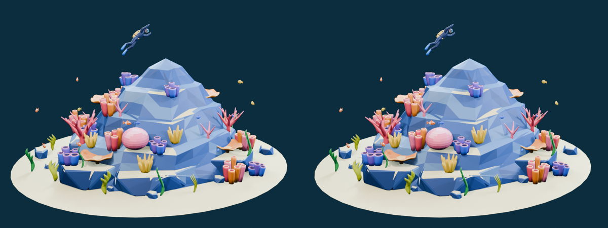

# Step 06 總結 — 匯出 GLB

對應 roadmap：[roadmap/06-export-glb.md](../roadmap/06-export-glb.md)
狀態：完成（2026-10-20）

## 代表結果



同相機、同打光:左邊是原 `.blend` 場景,右邊是把 `export/reef.glb` 在另一個全新 Blender 程序 import 後的 render。九張影像的平均 RGB 差都在 1e-6 等級,肉眼無法分辨,這就是「GLB 存活」的證據。

代表程式碼:匯出呼叫([03_export.py](../blender/scripts/03_export.py) `export_asset`),只選 `Scene_Root` 子樹,不帶相機、燈光、動畫

```python
bpy.ops.export_scene.gltf(
    filepath=str(GLB), export_format='GLB', use_selection=True, use_visible=True,
    use_renderable=True, export_yup=True, export_apply=True,
    export_shared_accessors=True, export_texcoords=True, export_normals=True,
    export_materials='EXPORT', export_image_format='AUTO',
    export_cameras=False, export_lights=False, export_animations=False,
    export_skins=False, export_morph=False, export_gpu_instances=False,
    ...
)
```

代表資料:[export/asset_manifest.json](../export/asset_manifest.json)

```json
{
  "asset": "reef.glb", "bytes": 625268, "up_axis": "+Y",
  "nodes": 95, "mesh_nodes": 91, "meshes": 26,
  "triangles": 49420, "unique_triangles": 16690,
  "materials": 1, "textures": 1, "texture_size": [64, 64],
  "animations": 0, "cameras": 0, "lights": 0,
  "extensions_used": [], "draco": false, "embedded_resources_only": true,
  "excluded_objects": ["Camera", "Key_Softbox", "Fill_Softbox", "Rim_Softbox"]
}
```

## 這一步做了什麼

1. 讀取通過 Step 05 的場景，核對驗證紀錄與檔案 SHA-256。
2. 新增 `blender/scripts/03_export.py`，只匯出 `Scene_Root` 及其子物件，保留共享 mesh、零件名稱、階層與互動 pivots。
3. 排除相機、燈光及未使用資料；輸出 +Y up、單一材質與內嵌色票的 `export/reef.glb`。
4. 自動啟動另一個 Blender 程序，清空場景後 import GLB；比對逐物件幾何、world matrix、父子關係、共享 mesh 與材質。
5. 在相同相機、燈光與色彩設定下重 render 六視角及三張角色近照，進行影像差異量測及實際視覺審視。
6. 使用固定版本的官方 glTF Validator 與獨立 Blender asset inspector 檢查 GLB。

## 產出

| 檔案 | 內容 |
|---|---|
| [export/reef.glb](../export/reef.glb) | 625,268 bytes 的自含 Web asset |
| [blender/scripts/03_export.py](../blender/scripts/03_export.py) | 匯出、GLB 結構檢查、全新程序重新匯入及九視角比對 |
| `tools/gltf/validate.mjs`、`package.json`、`package-lock.json` | 可重跑的官方 validator，固定版本 `2.0.0-dev.3.10` |
| [export/REPORT.md](../export/REPORT.md) | 數字、設定、驗證、互動結構與後續限制 |
| `export/asset_manifest.json` | 資產數字與來源／腳本／GLB hashes |
| `export/roundtrip_checks.json` | 每個物件的幾何與 transform 誤差、九張渲染差異 |
| `export/validator.json`、`metrics.json` | 官方格式驗證及獨立 inspector |
| `export/hierarchy.txt` | 完整 95-node 階層與 mesh 資料引用 |
| [主視角比對](../blender/renders/export/hero_comparison.png) | 左為原場景，右為 GLB 重新匯入 |
| [六視角總覽](../blender/renders/export/contact_sheet.png) | 重新匯入後的六個角度 |

## 技術說明

| 指標 | 結果 |
|---|---:|
| GLB 大小 | 0.625268 MB，低於 1.5 MB |
| 場景 / unique triangles | 49,420 / 16,690，與原場景一致 |
| Nodes / mesh nodes / shared mesh 資料 | 95 / 91 / 26 |
| Materials / textures | 1 / 1（64×64 PNG） |
| Animation / camera / light | 0 / 0 / 0 |
| Validator errors / warnings | 0 / 0 |
| 重新匯入頂點位置最大誤差 | 約 2.39×10⁻⁷ m |
| World matrix 最大元素差 | 約 3.58×10⁻⁷ |
| 九張渲染最大平均 RGB 差（0–1） | 約 1.114×10⁻⁶ |

原本的正值、等比例 placement transforms 是互動結構的一部分。GLB 能保留這些 transforms，因此未將每個 instance 的旋轉／縮放烘入獨立幾何；Apply Modifiers 開啟，但來源已沒有未套用 modifier。
左右蛙鞋仍為各自 node，並繼續共用同一份 mesh。

Fresh import 使用來源法線，保留 glTF 的拆分頂點。glTF 需要為不同 normal／UV 儲存不同頂點，因此匯入後 boundary edges 統計會增加；以頂點位置、面數、UV、材質及渲染比對確認外觀與尺度。

沒有使用 Draco 或必要 extension。GLB 已在預算內，網頁端可直接用 GLTFLoader 載入；完整檔案不依賴外部 texture URL。

重跑：

```bash
blender --background --factory-startup --threads 2 --python-exit-code 1 --python blender/scripts/03_export.py
npm ci --prefix tools/gltf
npm --prefix tools/gltf run validate
```

## Takeaway

- 匯出成功只是第一關；另一個程序重新 import，才能檢查實際交付的二進位檔。
- glTF mesh 資料與 node 是不同層次：91 個網格物件可以共用 26 份幾何，同時保持各自可互動。
- 共用 mesh 不會自動減少瀏覽器 draw calls。未 batching 前約 91 次 mesh draw／pass，後續仍需 instancing／batching 與效能量測。
- 頂點／邊界數不能直接拿 Blender 編輯網格與 glTF 渲染網格相比；normal／UV 接縫會拆頂點，應同時檢查空間位置與最終外觀。
- 這一步交付靜態 mesh、材質、階層與 transforms；游動、海草擺動、燈光與互動仍由 Web 實作。
- 下一步 Step 07：最小 Three.js viewer，先驗證瀏覽器載入與控制，再進行網站製作。
