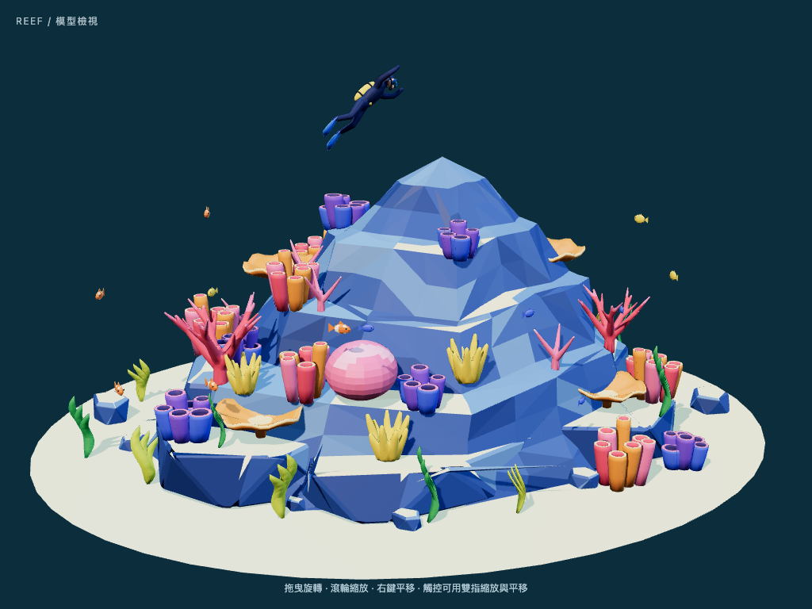

# Step 07 總結 — 最小 Three.js Viewer

對應 roadmap：[roadmap/07-minimal-threejs-viewer.md](../roadmap/07-minimal-threejs-viewer.md)
狀態：完成（2026-10-20）

## 代表結果



1024×768 的 Chrome 實際截圖。構圖與 Blender 主視角接近，沙地、潛水員與魚群完整入鏡；
岩塊藍色、粉／紫／橘珊瑚與綠色海草可辨識。Web 的陰影較硬、藍色較飽和，未聲稱逐像素相同。

```ts
renderer.outputColorSpace = SRGBColorSpace
renderer.toneMapping = ACESFilmicToneMapping
renderer.toneMappingExposure = 1
renderer.setPixelRatio(Math.min(window.devicePixelRatio, 1.5))
```

## 這一步做了什麼

1. 建立 `web/` 的 Vue 3 + Vite + TypeScript 專案，所有 Three.js 邏輯獨立在 `src/three/`。
2. 載入經 Step 06 驗證的 GLB；`dev` / `build` 啟動時自動同步來源，避免檢視舊副本。
3. 設定 PerspectiveCamera、sRGB、ACES、基本主光／補光／輪廓光及接觸陰影。
4. 沿用 Blender 的 hero 方位 −12°、仰角 17°、50 mm 鏡頭與 target；窄螢幕依實際頂點自動拉遠。
5. 開啟 OrbitControls，支援旋轉、縮放、平移；加上載入與錯誤提示、resize、卸載清理。
6. 用 Chrome 實際執行四項瀏覽器測試，再審視桌機、旋轉後及手機尺寸截圖。

## 產出

| 檔案 | 內容 |
|---|---|
| [web/README.md](../web/README.md) | 啟動、build、測試、程式導覽與限制 |
| `web/package.json`、`web/bun.lock` | 固定版本的依賴與可重現安裝 |
| `web/src/pages/Viewer.vue` | 全螢幕模型頁 |
| `web/src/three/` | renderer、scene、loader、camera 與 lifecycle |
| `web/scripts/sync-model.mjs` | 每次 dev / build 同步 GLB |
| `web/tests/viewer.spec.ts` | 載入、階層、操控、尺寸、DPR 與失敗情境 |
| [主視角](assets/07-viewer.png) | 本次完成的瀏覽器畫面 |
| [手機尺寸](assets/07-viewer-mobile.png) | 390×844，模型完整顯示 |

## 技術說明

| 驗證 | 結果 |
|---|---|
| `bun run build` | TypeScript 與 production build 通過 |
| `PLAYWRIGHT_CHANNEL=chrome bun run test` | 4 passed |
| 載入檔案 | 與 `export/reef.glb` 的 SHA-256 完全一致 |
| 階層 | 95 個 node 的名稱及 parent 全部與 GLB 一致 |
| 網格／面數 | 91 mesh nodes、49,420 triangles |
| 操控 | 拖曳旋轉及滾輪縮放後畫面確實改變 |
| 尺寸 | 1024×768 與 390×844；無水平 overflow |
| DPR | 裝置 DPR 3 時，390×844 canvas buffer 為 585×1266（1.5×） |
| 失敗情境 | GLB 404 與無 WebGL 都顯示可讀提示 |
| 一般載入 | 無 console error 或未捕捉例外 |

這次測試使用 Chrome + SwiftShader，驗證功能與可見結果，不能當作真實 GPU 的效能量測。
瀏覽器截圖與 shader 編譯皆成功；正式桌機／手機效能仍屬後續步驟。

GLTFLoader 讀取內嵌色票與 PBR 材質，沒有額外改寫 roughness、metalness 或 emissive。
此模型原本即為 roughness 0.55、metallic 0、無 emissive，因此不以發光作為完成條件。
Blender 的 AgX 與本頁 ACES 不同；基本色相與明暗可辨識，Step 08 再做水下氣氛調整。

TypeScript 7 與目前 vue-tsc 不相容，已固定為 5.9.3；Three.js 使用 0.186.1，
陰影採此版本支援的 `PCFShadowMap`。Build JS 約 698 kB／gzip 184 kB，
仍有 Vite 500 kB chunk 提示，尚未進行後續網站載入與效能優化。

## Takeaway

- 框位要以可見幾何檢查：錐狀礁石的 bounding-box 空角會讓相機退得太遠；改用實際頂點後接近 Blender 構圖。
- 保留 GLB 子節點的 local transforms，只移動載入後的外層節點，後續零件動畫仍可用原有 pivots。
- 瀏覽器成功載入還不夠；階層、縮放旋轉、錯誤路徑和截圖應一起驗證。
- 下一步為 [Step 08：瀏覽器調光](../roadmap/08-web-lighting.md)。
