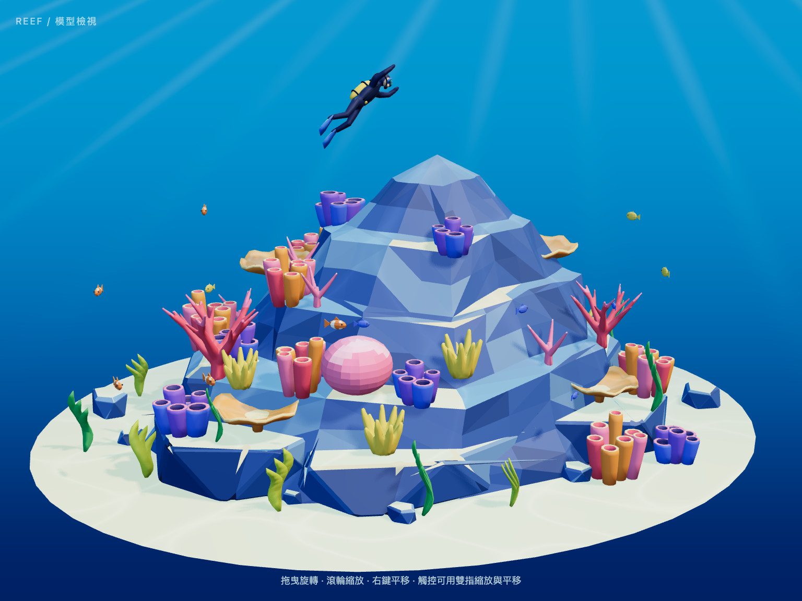
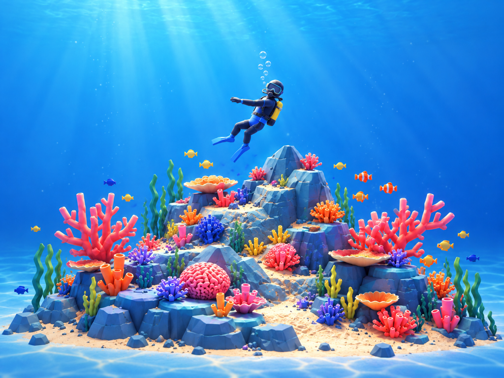

# Step 08 總結 — 瀏覽器水下調光

對應 roadmap：[roadmap/08-web-lighting.md](../roadmap/08-web-lighting.md)

狀態：完成（2026-10-20）

## 代表結果



主視角保留原來的取景與幾何，加入藍色水域、上方光束、冷色輪廓光、淡霧與緩慢水紋。
岩塊切面與珊瑚色相仍可辨識；陰影的對比降低，珊瑚僅有微量自發光。

| Concept 氛圍參考 | Step 07 基準 | Step 08 調光 |
|---|---|---|
|  |  |  |

這次比對的是水色、入光、景深感及珊瑚與背景的對比。Concept 的氣泡、幾何細節與構圖差異
不是本步修正範圍；沒有修改 Blender 模型，也沒有宣稱與 reference 完全相同。

代表設定（節錄自 `web/src/three/lightingConfig.ts`）：

```ts
exposure: 1,
key: { color: '#fff2d7', intensity: 3.3, position: [3, 5, 2] },
shadow: { radius: 4, intensity: 0.65 },
environmentIntensity: 0.12,
caustics: { strength: 0.18, scale: 5, speed: 0.35, animated: true },
material: {
  roughness: 0.58, metalness: 0,
  coralEmissive: '#ffd5dc', coralIntensity: 0.05,
},
```

## 這一步做了什麼

1. 將燈光從 `createScene.ts` 移至 `createLighting.ts`，所有可調參數集中為可序列化的 config。
2. 設定右上主光、藍色補光與輪廓光、柔化陰影及低強度環境反射。
3. 加入漸層水色、背景光束、隨時間移動的表面水紋，以及配合相機距離調整的霧氣。
4. 為 Branch／Brain／Tube 珊瑚共用一份額外材質，以原色票控制發光顏色，避免全場景一起發光。
5. `?debug` 動態載入 lil-gui 與 stats.js，提供參數調整、JSON 輸出及重設。
6. 確認減少動態效果時水光停止、卸載會清除面板與 WebGL 資源。
7. 完成七項瀏覽器測試、桌機 GPU 幀率量測及桌機／手機截圖審視。

## 產出

| 檔案 | 內容 |
|---|---|
| [lightingConfig.ts](../web/src/three/lightingConfig.ts) | 本次調好的預設值與資料型別 |
| [createLighting.ts](../web/src/three/createLighting.ts) | 燈光、環境反射、霧氣與生命週期 |
| `createWaterBackground.ts`、`createWaterMaterials.ts` | 背景光束、水紋、珊瑚發光 |
| [createLightingDebug.ts](../web/src/three/createLightingDebug.ts) | 調光面板、JSON 輸出、還原與 FPS |
| [lighting.spec.ts](../web/tests/lighting.spec.ts) | 面板、動畫偏好、匯出／還原與清理測試 |
| [inspect-lighting.mjs](../web/scripts/inspect-lighting.mjs) | 可重跑的 GPU 幀率量測與截圖 |
| [主視角原圖](../web/screenshots/lighting-v1.png) | 1024×768 CSS pixels、DPR 1.5 |
| [手機尺寸](../web/screenshots/lighting-mobile.png) | 390×844 CSS pixels，模型沒有被霧遮住 |
| [調光面板](../web/screenshots/lighting-debug.png) | 面板與 stats.js 實際畫面 |
| [量測報告](../web/screenshots/lighting-report.json) | GPU、FPS、console errors、模型／設定／截圖 hashes |

## 技術說明

| 驗證 | 結果 |
|---|---|
| `bun run build` | TypeScript 與 production build 通過 |
| `PLAYWRIGHT_CHANNEL=chrome bun run test` | 7 passed |
| 模型檔 SHA-256 | 仍為 `0abac7e1…cd2a5`，與 Step 06 一致 |
| 階層／面數回歸 | 95 nodes、91 mesh nodes、49,420 triangles 與來源一致 |
| 一般預覽 | 不載入 GUI／stats 模組，不顯示 debug UI |
| 即時調參 | 曝光變化會改變模型區域像素，匯出 JSON 與重設皆通過 |
| 減少動態效果 | 畫面保持靜止；取消偏好後水光繼續 |
| 卸載 | 重複 dispose 安全，canvas／GUI／stats 都移除 |
| 一般載入及調光 | 沒有 console error 或未捕捉例外 |

效能取樣使用 **Chrome 155 headless / Apple M4 / ANGLE Metal**，
不是測試套件使用的 SwiftShader。暖機 2 秒後，保持 **1440×900、DPR 1.5、
水光動畫與 GUI／stats 開啟**，取樣 10.016 秒：

| 指標 | 數值 |
|---|---:|
| 影格數 | 601 |
| 平均 FPS | 60.003 |
| median frame interval | 16.7 ms |
| p95 frame interval | 16.8 ms |
| 超過 25 ms 的影格 | 0 |
| Canvas buffer | 2160×1350 |

這滿足本機本次短時間測試的桌機 60 FPS 目標；尚未做跨裝置或長時間的 Step 17 audit。
stats.js 截圖的歷史範圍包含剛開始載入的時段，量測表則排除了暖機。

環境反射使用一次性生成的 128px PMREM，不下載 HDR。背景只增加一個平面 draw call；
GLB 本身不增加 geometry，材質由一份變成兩份但仍共用色票。沒有 bloom 或真正的體積光。
模型與燈光目前靜止，因此 shadow map 只在載入或調光時更新；
之後加入魚／海草／潛水員動畫時，必須重新安排陰影更新。

霧氣 near/far 隨相機距離平移，讓手機窄畫面自動拉遠時仍保有相似的可見程度。
這是展示用的美術設定，不是物理水體模擬。

重跑：

```bash
cd web
bun run dev
# 另一個終端機
cd web
bun run inspect:lighting
```

## Takeaway

- 環境色、曝光與陰影對比需要一起看；第一版偏亮的填光與明顯光束已降低。
- 共用材質適合縮小 GLB，但只讓部分零件發光時，應建立少量共用變體，不能直接改全場景的唯一材質。
- 動態水光會讓截圖自然變動；操控回歸測試固定水光後，才能真正驗證相機旋轉與縮放。
- FPS 結果要附 GPU、解析度、DPR、取樣時間與 debug 狀態。
- 下一步是 [Step 09：網站 mockup](../roadmap/09-website-mockup.md)。
