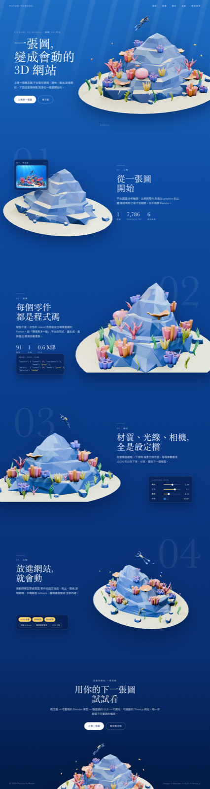

# Step 09 總結 — 網站 Mockup

對應 roadmap:[roadmap/09-website-mockup.md](../roadmap/09-website-mockup.md)

狀態:完成(2026-10-20)

## 代表結果



網站是**圖轉 3D 平台(Picture to Model)的產品頁**,珊瑚礁是示範 asset,用來演示平台四個階段。
選定 `homepage-01`(編輯排版):深藍單一背景延續 Step 08 的水色;模型在六段裡左右交替、
繞行一整圈(旋轉 Y 累計 0° → −360°),文字區固定 520 px 寬,UI 道具(輸入圖、設定檔、調光面板、功能 chips)放在文案同側。
三張候選的桌機與手機版都在 [mockups/](../mockups/)。

代表資料（Step 09 當時的建議值；Step 10 校正後的現行值見 [mockups/SECTIONS.md](../mockups/SECTIONS.md)）：

| # | Section | 平台階段 | 模型位置 | 旋轉 Y | 縮放 | 零件狀態(group: t) | UI 道具 |
|---|---|---|---|---|---|---|---|
| 1 | Hero | 一張圖,變成會動的 3D 網站 | 置中偏右 | 0° | 1.0 | 全部 0 | — |
| 2 | 上傳 | 從一張圖開始(graybox) | 左側 | −35° | 1.0 | rocks 1→0(stack);boulders 0;corals、kelp、diver、fish 1 | 概念圖輸入卡片 |
| 3 | 建模 | 每個零件都是程式碼 | 右側 | −100° | 1.25 | corals、kelp 1→0(grow);diver、fish 1 | `model.spec.json` 卡片 |
| 4 | 調光 | 材質、光線、相機是設定檔 | 置中偏左 | −160° | 1.1 | diver 1→0(path);fish 1 | `lighting.json` 滑桿面板 |
| 5 | 互動 | 放進網站就會動 | 置中偏右 | −230° | 0.9 | fish 1→0(orbit) | 功能 chips |
| 6 | CTA | 用你的下一張圖試試看 | 置中偏下 | −360° | 0.85 | 全部 0 | footer |

## 這一步做了什麼

1. 這個環境沒有影像生成工具,改用「Blender 透明 render + HTML 排版 + Chrome 截圖」做 mockup。
   `blender/scripts/04_mockup_renders.py` 讀 `02_detail.blend`,依每段的累計旋轉、仰角與零件可見性
   輸出六張 1600×1200 透明 PNG(`blender/renders/mockup/`)與 `manifest.json`。
2. 第一版把網站寫成「珊瑚礁模型介紹頁」,使用者指出方向錯誤:主角是圖轉 3D 平台,模型只是示範。
   改寫成產品頁:Hero 講「一張圖變成會動的 3D 網站」,四個流程段(上傳 → 建模 → 調光 → 互動)各用一個零件 mode 演示,CTA 回到「上傳你的下一張圖」。
3. 零件動畫與平台階段一對一:graybox = 岩層堆起、可重現建模 = 珊瑚長出、調光 = 潛水員下潛、互動 = 魚群環繞;
   六張 render 和模型狀態表因此不用重做,只換文案與 UI 道具。
4. 用同一套文案與六張 render 做三種版面:
   `homepage-01` 編輯排版(襯線標題,模型左右交替)、`homepage-02` 流程卡片(水色 / 沙色交替面板,進度列與玻璃卡片)、
   `homepage-03` 流程儀表(全深色,左側步驟刻度,模型固定置中)。
5. 每段加入產品 UI 道具:概念圖輸入卡片(真的用 `references/final-concept.png`)、`model.spec.json` 程式碼卡片、
   `lighting.json` 滑桿面板(數值取自 Step 08 的實際設定)、功能 chips。
6. `web/scripts/render-mockups.mjs`(`bun run mockups`)把每個 HTML 截成 1440 寬整頁與 390 寬手機版;
   兩輪截圖修掉文字壓到模型、數字落在沙地上、標題折行、程式碼卡片溢出。
7. 依 roadmap 五項評估選定 01,寫 `SECTIONS.md`,並依規則把 PROJECT_SPEC 裡未使用的 `explode` 列刪除。

## 產出

| 檔案 | 內容 |
|---|---|
| [final-homepage.png](../mockups/final-homepage.png) · [final-homepage-mobile.png](../mockups/final-homepage-mobile.png) | 選定版(= homepage-01)桌機與手機 |
| `mockups/homepage-01/02/03.png`、`*-mobile.png` | 三張候選各兩種尺寸 |
| [SECTIONS.md](../mockups/SECTIONS.md) | 六段的平台階段、位置、累計旋轉、縮放、相機仰角、零件 `t`、UI 道具、過渡與版面規則 |
| [mockups/src/](../mockups/src/) | `base.css`(含 UI 道具樣式)+ 三個 HTML 來源,可改字改版重截 |
| [04_mockup_renders.py](../blender/scripts/04_mockup_renders.py) | 透明背景、逐段零件可見性的 Blender render 腳本 |
| [render-mockups.mjs](../web/scripts/render-mockups.mjs) | Playwright / Chrome 整頁截圖 |
| `blender/renders/mockup/` | 六張透明 render 與 manifest(gitignore,腳本重建) |

## 技術說明

評估(roadmap 的五個問題):

| 評估項 | 01 編輯排版 | 02 流程卡片 | 03 流程儀表 |
|---|---|---|---|
| 3D 動線 | 左右交替 + 繞一圈,每段位移明確 | 置中微偏,位移小 | 幾乎固定置中,只換角度 |
| 文字空間 | 固定 520 px 欄,UI 道具在同側下方,零重疊 | 卡片與道具分上下兩塊,hero 需把模型壓到下緣 | 左下文案與沙地邊緣貼近,道具只能放右下 |
| 視覺一致 | 單一深藍漸層,與 Step 08 水色相同 | 沙色面板與水下氛圍衝突,固定 canvas 要逐段換背景 | 一致,但全深色讓珊瑚色票不如 01 清楚 |
| 可實作性 | 固定 canvas + 文字與道具捲過,無額外 3D | 進度列與卡片都是 UI,簡單;背景切換要多做 | 步驟刻度是純 UI,簡單 |
| 手機 | 文字 → 道具 → 模型,成立 | 卡片堆疊成立 | 數字 + 文案 + 道具成立 |

選 01 的主因是動線與一致性;02 的進度列可做為 Step 12 的進度指示,03 的步驟刻度同理。

產品頁的敘事邏輯:零件動畫不是為了介紹模型,而是把平台的每個階段「演」出來。
這讓 Step 12 / 13 的動畫有明確用途,也讓 Hero 與 CTA 都能用完整的示範 asset。
UI 道具裡的數字(7,786 graybox tri、91 零件、0.6 MB、曝光 1.0、主光 3.3、霧氣 0.18)都取自 Step 03–08 的實際結果,
之後實作時應從對應的 config / report 讀,不要寫死。

相機約定:mockup 的「模型旋轉 +r」等於相機方位角 −r(`azimuth = hero_azimuth − rotation`),
六張 render 的方位、仰角、距離寫在 `manifest.json`,Step 12 若要 tween 相機可直接取用。
旋轉寫成累計負值(CTA 為 −360°),避免 GSAP 從 −230° 轉回 0° 走反方向。

零件狀態與 PROJECT_SPEC 的對應:`stack`、`grow`、`path`、`orbit` 各佔一段;`boulders` 沒有 mode,
全程 `t = 0`,和沙地一起當錨;`explode` 無段落使用,已從 spec 刪除。
1 → 2 的「倒帶」是唯一一次多個 group 同時 0→1,寫在 SECTIONS.md 的過渡表。

截圖是 Chrome(channel `chrome`)、DPR 1、`fullPage`;字型用 macOS 內建的 Baskerville / Avenir Next / PingFang TC,
其他機器重截會換字型,版面不受影響。render 用 EEVEE 32 samples、`film_transparent`,
六張約 1.3–1.8 MB,mockup 整頁 PNG 約 3 MB。

重跑:

```bash
blender --background --factory-startup --threads 2 --python-exit-code 1 --python blender/scripts/04_mockup_renders.py
cd web && bun run mockups
```

## Takeaway

- **先確認網站在賣什麼,再排版**。第一版把示範 asset 當主角,整頁變成模型介紹;產品頁的每一段都該回答「平台替你做了什麼」。
- 沒有影像生成也能做 mockup:真實模型的透明 render 比生成圖更準,每段的零件狀態就是後面 Step 12/13 的 spec,不會畫出做不到的東西。
- 零件動畫對應平台階段之後,同一套 render 可以換三種版面、換兩種故事,SECTIONS.md 的 3D 欄位都不用動。
- 「文字會不會壓到模型」要用整頁截圖看,HTML 裡的數字猜不準;兩輪共修了五處。
- 旋轉用累計角度寫進 spec,比在程式裡補 2π 更不容易出錯。
- 下一步是 [Step 10:依 mockup 實作網站](../roadmap/10-implement-website.md)。
