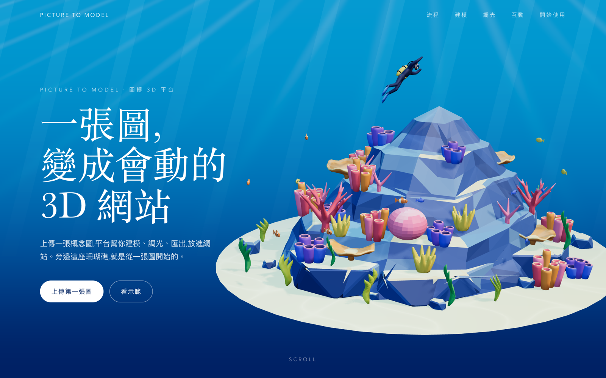

# Step 10 總結 — 把 Mockup 做成真正網頁

對應 roadmap：[roadmap/10-implement-website.md](../roadmap/10-implement-website.md)

狀態：完成（2026-10-21）

## 代表結果



Hero 與 [mockups/final-homepage.png](../mockups/final-homepage.png) 的構圖一致：文字欄在左，模型在右偏下，
光束與水色沿用 Step 08。整頁六段見 [assets/10-landing-full.png](assets/10-landing-full.png)。

代表資料（`web/src/three/config/sections.ts`，與 SECTIONS.md 1:1）：

```ts
{
  id: 'upload', position: [-1.1, -0.2, 0], rotation: [0, -35, 0], scale: 0.9,
  camera: { elevation: 21, distance: 1 },
  parts: { rocks: 0, boulders: 0, corals: 1, kelp: 1, fish: 1, diver: 1 },
  partsOnEnter: { rocks: 1 }, emissive: 1,
}
```

`rotation` 是累計角度（CTA 為 −360°），`parts` 是該段結束時每個 group 的 departure `t`，
`partsOnEnter` 是進入該段時的值，兩者之差就是 Step 12/13 在該段 pin 住時要播的零件動畫。

## 這一步做了什麼

1. 把頁面拆成兩個入口：`/` 是 landing page，`/viewer.html` 保留 Step 07–08 的模型檢視頁與調光面板，舊測試只改 URL。
2. 建立 `src/three/` 的新結構：`Scene.ts`（renderer / 場景 / 相機 / loop / 生命週期）、`Model.ts`（GLB、`parts`、`groups`、`setMaterialParam`）、
   `CameraController.ts`（Hero 取景、依 section 仰角與距離擺相機）、`config/sections.ts`、`config/partGroups.ts`、`config/partAnimations.ts`。
3. 從 `Viewer.ts` 抽出 `framing.ts`（頂點投影取景），兩個頁面共用同一套「保留 Blender 相機距離、窄螢幕才拉遠」的邏輯。
4. Vue 端：`useThreeScene()` 是唯一橋接，回傳 `status` 與 `setSectionState / setPointer / pause / resume`；`App.vue` 放固定的 `.stage` 容器與六個 section 元件。
5. 依 mockup 01 寫 `landing.css`：12 欄 grid、襯線標題、段落大數字、四種產品 UI 道具（概念圖卡片、`model.spec.json`、`lighting.json` 滑桿面板、功能 chips）。
   調光面板的數值直接讀 `lightingConfig.ts`，不是手打。
6. 用 Chrome 截圖對照 mockup，校正每段的 `position / scale`（例如 Hero 從建議的 x +0.6 改成 +1.2、scale 0.92），
   並把校正後的值回寫 SECTIONS.md。`?state=N` 讓 Step 12 之前就能預覽各段的 3D 狀態。
7. 新增 `tests/landing.spec.ts` 三項測試與 `scripts/inspect-landing.mjs`（Chrome / 真 GPU 截圖與 FPS）。
8. 測試抓到 `^Fish_` 會把容器 empty `Fish_Root` 算進魚群（16 而非 15）；pattern 改為 `^Fish_[A-C]_`，PROJECT_SPEC 同步修正。

## 產出

| 檔案 | 內容 |
|---|---|
| [App.vue](../web/src/App.vue) · [components/](../web/src/components/) | 固定 canvas 容器 + `SiteNav` 與六個 section 元件 |
| [useThreeScene.ts](../web/src/composables/useThreeScene.ts) | Vue ↔ Three 唯一橋接 |
| [Scene.ts](../web/src/three/Scene.ts) · [Model.ts](../web/src/three/Model.ts) · [CameraController.ts](../web/src/three/CameraController.ts) | Three.js 場景、模型索引、相機 |
| [config/sections.ts](../web/src/three/config/sections.ts) · [partGroups.ts](../web/src/three/config/partGroups.ts) · [partAnimations.ts](../web/src/three/config/partAnimations.ts) | SECTIONS.md 與 PROJECT_SPEC 的 plain object 版本 |
| [framing.ts](../web/src/three/framing.ts) | 共用取景計算；`Viewer.ts` 已改用 |
| [landing.css](../web/src/landing.css) · `index.html` · `viewer.html` · `vite.config.ts` | 版面與雙入口 |
| [landing.spec.ts](../web/tests/landing.spec.ts) · [inspect-landing.mjs](../web/scripts/inspect-landing.mjs) | 測試與截圖／FPS 腳本 |
| [landing-hero.png](../web/screenshots/landing-hero.png) · [landing-full.png](../web/screenshots/landing-full.png) · [landing-mobile.png](../web/screenshots/landing-mobile.png) · [landing-report.json](../web/screenshots/landing-report.json) | Chrome / Metal 截圖與量測 |
| `src/assets/final-concept-800.jpg` | 概念圖 800 px 版，給輸入卡片 |

## 技術說明

| 驗證 | 結果 |
|---|---|
| `bun run build` | 兩個入口的 TypeScript 與 production build 通過；landing 主 JS 13 kB + 共用 Three chunk 686 kB（gzip 182 kB） |
| `PLAYWRIGHT_CHANNEL=chrome bun run test` | 10 passed（模型檢視頁 7 項 + landing 3 項） |
| Section | 六個 `<section>` 依 SECTIONS.md 順序存在，標題文字相符 |
| Canvas | 只有一個，`position: fixed`、`pointer-events: none`，捲到 CTA 後 bounding box 仍是 (0, 0, 1440, 900) |
| Part groups | rocks 7 / boulders 12 / corals 35 / kelp 16 / fish 15 / diver 1，共 95 nodes |
| `?state=3` | canvas 畫面與 Hero 不同，證明 `setSectionState` 走通 |
| 手機 390 寬 | `scrollWidth` 390，canvas buffer 跟著 viewport |
| GLB 404 | 顯示 alert，文案仍可讀 |
| 效能 | Chrome 155 / Apple M4 / ANGLE Metal、1440×900、DPR 1.5、Hero 停留 5 秒：平均 60.0 FPS、p95 16.8 ms、0 console error |

架構依 roadmap：Vue 不碰 Three 物件，Three 只收 container 與數值；lighting / sections / partGroups / partAnimations 全是可序列化的 plain object
（pattern 存字串，由 `Model.ts` 編譯成 RegExp）。roadmap 列的 `config/materials.ts` 沒有另開，材質參數仍在 `lightingConfig.material`，避免同一份值兩處維護。

`Model.ts` 不再像 `loadModel.ts` 那樣把包裝節點移到 bounding box 中心，而是保留 Blender 的世界原點（礁石底部中心），
所以 `sections.ts` 的 `position` 與 `partAnimations.ts` 的 `center / offsets` 都在同一個座標系，Step 12/13 不用換算。

窄螢幕（aspect < 0.8）時 `CameraController` 把注視點往上抬 2.4 m，讓模型落在文字下方；這只是 Step 14 做靜態 fallback 之前的過渡，
手機截圖裡模型仍是活的 WebGL。Playwright 的元素截圖會連同疊在上面的 DOM 一起擷取，所以「捲動後 3D 狀態不變」改用 canvas 幾何與 `?state=N` 的差異來驗證。

重跑：

```bash
cd web
bun run dev
# 另一個終端機
cd web && bun run inspect:landing
```

## Takeaway

- **mockup 的「建議數值」要用截圖校正**：Hero 的 x 偏移從 +0.6 變 +1.2，差了一倍；校正後回寫 SECTIONS.md，讓文件跟程式一致。
- **把 Blender 原點留著**比重新置中省事：section、orbit center、path offsets 共用同一座標系。
- **測試該查 group 數量**：一個 `^Fish_` 的 pattern 讓容器混進魚群，render 看不出來，數字一比就出來。
- **一個 canvas、Vue 只給數值**的分法，讓 `?state=N` 這種預覽幾乎免費，Step 12 只要把 scroll 進度映射到 `setSectionState`。
- 下一步是 [Step 11：滑鼠跟隨互動](../roadmap/11-pointer-interaction.md)。
