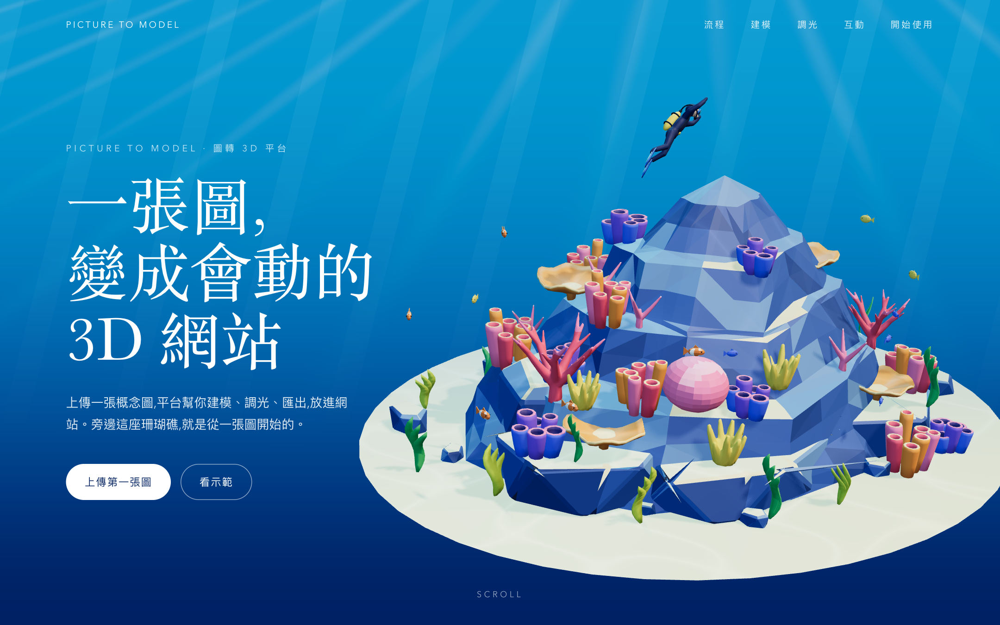

# Step 11 總結 — 滑鼠跟隨互動

對應 roadmap：[roadmap/11-pointer-interaction.md](../roadmap/11-pointer-interaction.md)

狀態：完成（2026-10-21）

## 代表結果



游標移動讓整座礁石微轉，離開或失焦後平滑回正。Hero 四角檢查中，主峰、潛水員與文字仍完整可讀；
右側沙地沿用原有延伸出畫面邊緣的構圖。中性與四角截圖保存在 `web/screenshots/pointer-*.png`。

```ts
export const pointerConfig: PointerConfig = {
  mode: 'tilt',
  maxRotationX: 0.08,
  maxRotationY: 0.15,
  damping: 0.08,
  stiffness: 1,
}
```

## 這一步做了什麼

1. 新增 `InteractionController.ts`：從 window 接收 mouse / pen 指標座標，正規化後以時間校正的指數阻尼追蹤目標。
2. 新增 `config/pointer.ts`：支援 `tilt` / `none`；最大 X / Y 角度、阻尼與反應速度倍率可調。PROJECT_SPEC 的選配魚群 `repel` 未實作。
3. 在 `Scene.ts` 每幀把偏移加到 section 的基礎旋轉，並在模型轉動時刷新陰影。`setPointer()` 使用同一條輸入路徑。
4. 處理視窗離開、失焦、指標取消與分頁隱藏；DOM 元素之間的 `pointerout` 不會誤判為離開視窗。
5. 動態偏好切換立即清除偏移，純觸控裝置停用；所有事件與 media query 監聽在 dispose 時移除。
6. 新增三項瀏覽器測試與截圖／效能腳本，更新規格、README 與進度索引。

## 產出

| 檔案 | 內容 |
|---|---|
| [InteractionController.ts](../web/src/three/InteractionController.ts) | 輸入、阻尼、偏好與生命週期 |
| [config/pointer.ts](../web/src/three/config/pointer.ts) | 模式與參數 |
| [Scene.ts](../web/src/three/Scene.ts) | 基礎角度 + pointer 偏移，動態陰影 |
| [pointer.spec.ts](../web/tests/pointer.spec.ts) | 三項互動測試 |
| [inspect-pointer.mjs](../web/scripts/inspect-pointer.mjs) | 六張截圖與持續傾斜時的 FPS 量測 |
| [pointer-report.json](../web/screenshots/pointer-report.json) | Chrome、GPU、量測條件、FPS 與錯誤紀錄 |
| [中性](../web/screenshots/pointer-neutral.png) · [左上](../web/screenshots/pointer-top-left.png) · [右上](../web/screenshots/pointer-top-right.png) · [右下](../web/screenshots/pointer-bottom-right.png) · [左下](../web/screenshots/pointer-bottom-left.png) · [回正](../web/screenshots/pointer-returned.png) | 視覺檢查證據 |

## 技術說明

使用 `alpha = 1 - (1 - damping) ** (deltaSeconds * 60 * stiffness)` 補間，保留規格在 60 Hz 的 0.08 響應，
並讓不同更新頻率下的速度一致。這是無回彈的阻尼，不是帶慣性的彈簧；`stiffness` 定義為速度倍率。
偏移距離低於 `1e-6` rad 時收斂到目標，避免持續刷新幾乎不動的陰影。

| 驗證 | 結果 |
|---|---|
| `bun run build` | TypeScript 與 production build 通過；既有共用 Three chunk 超過 500 kB 提示仍存在 |
| `PLAYWRIGHT_CHANNEL=chrome bun run test` | 13 passed：原有 10 項 + pointer 3 項 |
| 阻尼與角度 | 初幀不跳到目標；輸入 clamp；30 / 60 / 120 Hz 一秒響應一致；幅度不超過 0.08 / 0.15 rad |
| 回正 | window exit、leave、cancel、blur 回正；DOM 內移動不重設 |
| 實際渲染 | `?state=3` 保留 −100° 基礎角度；移動後畫面改變，離開後回到中性像素結果 |
| 動態偏好 | 啟用 reduce 立即回中性，後續游標移動不改變畫面 |
| 觸控 | touch 事件不產生偏移，純觸控裝置的數值輸入也停用，390 px 無橫向溢出 |
| 捲動與導覽 | wheel 可捲動；nav 可到調光 section；canvas 仍不攔截指標 |
| 效能 | Chrome 155 / Apple M4 / Metal，1440×900、DPR 1.5，持續傾斜並更新陰影與水光 5 秒：60.0 FPS，p95 16.7 ms，0 console error |

畫面測試只凍結水光時間，避免水紋變動造成誤判；效能量測維持水光動畫。
FPS 是本機短時間量測，不代表手機或其他硬體。

重跑視覺檢查：

```bash
cd web
bun run dev
# 另一個終端機
cd web && bun run inspect:pointer
```

## Takeaway

- pointer 只輸出角度偏移，section 保有基礎旋轉，後續 scroll 動畫可直接疊加。
- 固定 canvas 不接收事件時，window 監聽仍能讓模型回應，且不影響導覽與捲動。
- 模型轉動後需要更新陰影；只在 transform 改變時標記刷新即可。
- 下一步是 [Step 12：Scroll 驅動的敘事動畫](../roadmap/12-scroll-storytelling.md)。
