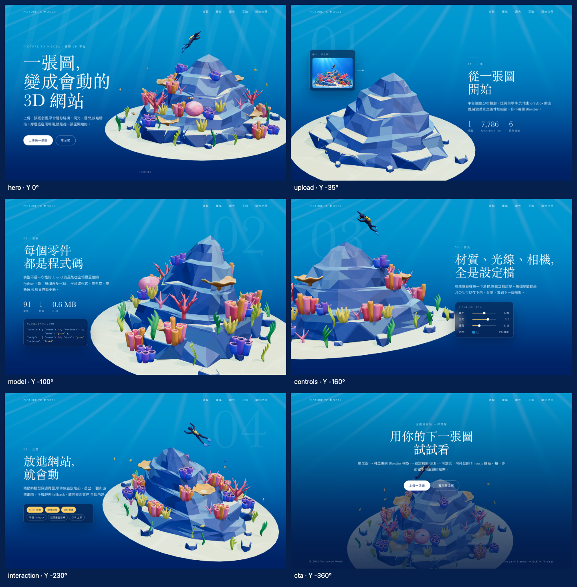

# Step 12 總結 — Scroll 驅動的敘事動畫

對應 roadmap：[roadmap/12-scroll-storytelling.md](../roadmap/12-scroll-storytelling.md)

狀態：完成（2026-10-21）；依前置條件同步完成 [Step 13](13-decomposable-model.md)。

## 代表結果



Hero 完整呈現，進入上傳段落時倒帶，再於四段停留期間依序還原零件；CTA 累計旋轉至 −360°。
上述畫面是實際捲動位置截圖，沒有用固定 `?state=N` 取代。

```ts
// ScrollController 只傳遞進度；零件效果由 PartAnimator 決定。
const entry = { ...target, parts: { ...target.parts, ...target.partsOnEnter } }
// 前半段：previous → entry；停留段：entry.parts → target.parts。
```

## 這一步做了什麼

1. `ScrollController.ts` 為每段建立獨立 plain state 與 GSAP timeline，每段一個 `scrub: true` ScrollTrigger。
2. `.story-step` 區間從 top bottom 到 bottom bottom，首尾相接。四個流程段增加一個 viewport 的停留距離，以 CSS sticky 固定文案。
3. 先插值位置、累計角度、縮放、相機仰角／距離與 emissive；停留期間只改零件進度。`config/sections.ts` 的數值未改。
4. Scene render loop 讀取 state，再疊加 Step 11 pointer；零件進度傳給 PartAnimator，陰影隨變換更新。
5. reduced-motion 不保留停留距離，直接切換目前段落的完成狀態；media change 監聽加每幀偏好核對，涵蓋初始化期間的切換。
6. 支援 deep link、頁內連結、resize、字型載入與卸載。`?state=N` 保留固定預覽；僅 dev 的 `?inspect` 提供唯讀狀態快照。

## 產出

| 檔案 | 內容 |
|---|---|
| [ScrollController.ts](../web/src/three/ScrollController.ts) | 捲動區間、timeline、導覽、偏好與清理 |
| [Scene.ts](../web/src/three/Scene.ts) | 每幀讀 state、疊加 pointer、套零件進度與發光倍率 |
| [useThreeScene.ts](../web/src/composables/useThreeScene.ts) · [App.vue](../web/src/App.vue) · [landing.css](../web/src/landing.css) | 掛載橋接、六個 wrapper 與 sticky |
| [scroll.spec.ts](../web/tests/scroll.spec.ts) | 捲動、減少動態效果、導覽、resize 與模型驗證 |
| [inspect-scroll.mjs](../web/scripts/inspect-scroll.mjs) | 六段與中間態截圖、draw calls 與實際 GPU 效能 |
| [scroll-report.json](../web/screenshots/scroll-report.json) | 每個截圖的狀態與零件變換、量測條件與結果 |
| [六段總覽](../web/screenshots/scroll-contact-sheet.png) · [手機](../web/screenshots/scroll-mobile.png) | 視覺證據 |

## 技術說明

| 驗證 | 結果 |
|---|---|
| Build | TypeScript 與 production build 通過；既有大 chunk 提示仍在 |
| 瀏覽器測試 | 16 passed，包含原有 landing / pointer / viewer / lighting 回歸 |
| 中間態 | Hero → upload 半程 Y = −17.5°，沒有跳到段尾 |
| 停留 | 四個流程段維持 section 就位，零件進度從 1 向 0 變化 |
| 可逆 | 快速回到 Hero 後，所有零件 local transform 精確回復 |
| Pointer | −100° 的段落角度上仍疊加不超過 0.15 rad 的游標偏移 |
| Reduced motion | 即時取消四個停留區段，直接套完成狀態，零件不繼續補間 |
| 生命週期 | 額外 controller dispose 還原 inline style，原頁面 controller 仍可運作 |
| 手機 | 390 px 無橫向捲動，可到 CTA；目前仍是 WebGL，靜態 fallback 留給 Step 14 |
| 效能 | Chrome 155 / Apple M4 / Metal、1440×900、DPR 1.5，完整往返捲動 5 秒約 60 FPS、p95 16.8 ms、0 console error |

GSAP tween 的 duration 在 scrub timeline 中代表捲動距離比例；本實作以內容高度與一個 viewport 表示移動與停留兩段比例。
參考：[GSAP ScrollTrigger 官方文件](https://gsap.com/docs/v3/Plugins/ScrollTrigger/)。

全段模型角度使用累計負角度，沒有在 CTA 把 −360° 改寫為 0°。各段狀態分開儲存，Scene 每幀只選目前區間，
避免前後 timeline 在往回捲時競爭同一份狀態。ScrollController 沒有任何零件 mode 分支。

```bash
cd web
bun run dev
# 另一個終端機
cd web && bun run inspect:scroll
```

## Takeaway

- 有零件敘事的 section 需要先完成 PartAnimator；只移動整座模型不足以完成 Step 12。
- sticky 負責內容停留，ScrollTrigger 負責數值，讓每段仍只需要一個 trigger。
- 測試段尾時要等零件進度也更新：停留期間角度不變，僅等待角度不能證明已到段尾。
- 下一步是 [Step 14：手機靜態圖 fallback](../roadmap/14-mobile-fallback.md)。
