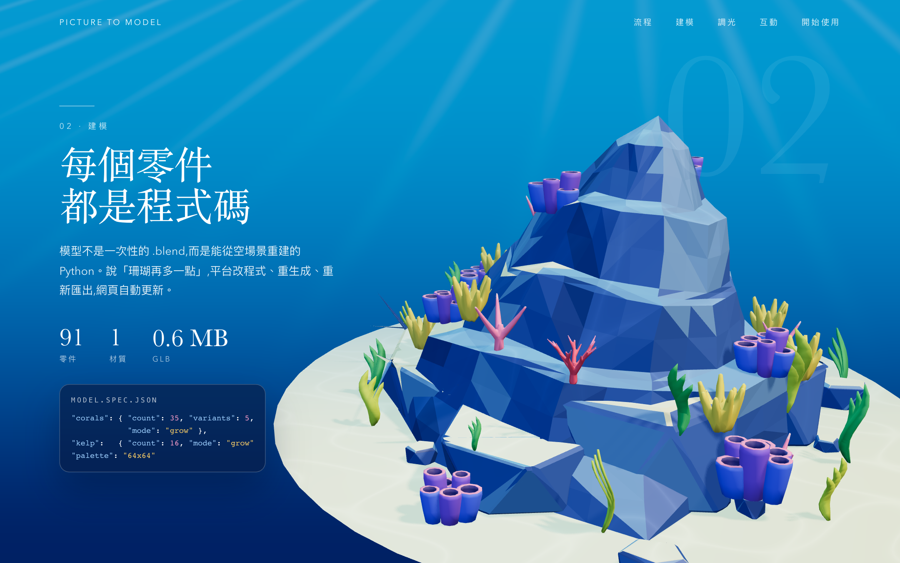

# Step 13 總結 — 逐件動畫與 instancing

對應 roadmap：[roadmap/13-decomposable-model.md](../roadmap/13-decomposable-model.md)

狀態：完成（2026-10-21），作為 Step 12 的前置依賴先行實作。

## 代表結果



75 個重複零件合成 12 個 InstancedMesh；可見模型物件 91 → 28，固定測試視角含陰影 draw calls 182 → 56，減少約 69%。
原本 95 個 named nodes 與 group 索引保留，動畫以它們作為 transform proxy，再同步至 instances。

```ts
rocks: { mode: 'stack', dropHeight: 1.5, order: 'height', stagger: 0.1, spring: 5, hideAtDeparture: true },
corals: { mode: 'grow', order: 'random', stagger: 0.03, overshoot: 0.15, spring: 6 },
```

## 這一步做了什麼

1. 確認 GLB 可動節點獨立、重複件共用 geometry，沿用 [Step 06](06-export-glb.md) 已驗證的 pivots 與階層，無需重做 Blender 模型。
2. `ModelInstances.ts` 按 parent / geometry / material 分批，至少四件才合批。原節點不移除，維持名稱與 local 座標；只有 render 改由 InstancedMesh 負責。
3. `PartAnimator.ts` 保存原始 position / quaternion / scale，支援 stack、grow、path、orbit 與驗證用 explode。曲線與暫存向量在初始化建立。
4. 每個零件保存獨立阻尼進度；岩塊以 bounding box 高度排序，珊瑚與海草使用名稱 hash 的固定亂數順序。
5. 進場 stagger 的總延遲上限 0.8，避免大量零件讓有效動畫區間歸零；`t=0` 精確還原 rest transform。
6. 補上明確的 `hideAtDeparture` 設定，使岩塊、潛水員與魚群在離場終點不顯示，符合上傳／建模段落的敘事。
7. instance 變換更新後同步 bounding box / sphere；model dispose 釋放 instance buffer 與共享資源。

## 產出

| 檔案 | 內容 |
|---|---|
| [PartAnimator.ts](../web/src/three/PartAnimator.ts) | mode 函式表、rest 狀態、排序、stagger 與阻尼 |
| [ModelInstances.ts](../web/src/three/ModelInstances.ts) · [Model.ts](../web/src/three/Model.ts) | 合批、代理、同步與釋放 |
| [partAnimations.ts](../web/src/three/config/partAnimations.ts) | 動作、速度、離場可見性參數 |
| [createWaterMaterials.ts](../web/src/three/createWaterMaterials.ts) | section 的珊瑚發光倍率，保留調光設定為基準 |
| [inspectParts.ts](../web/tests/fixtures/inspectParts.ts) | 瀏覽器內前後繪製、矩陣、零件狀態與換 mode 驗證 |
| [合批前](../web/screenshots/instances-before.png) · [合批後](../web/screenshots/instances-after.png) | 同光線、同相機的比較圖 |
| [scroll-report.json](../web/screenshots/scroll-report.json) | draw calls、面數、矩陣／像素差及還原結果 |

## 技術說明

GLB 分組補充（2026-10-21 依 `export/reef.glb` 的 node / mesh 引用盤點）：

| group | node 數 | 共用 mesh 定義數 | 轉成 instance 的 node 數 | 批次數 |
|---|---:|---:|---:|---:|
| rocks | 7 | 7 | 0 | 0 |
| boulders | 12 | 2 | 12 | 2 |
| corals | 35 | 7 | 32 | 5 |
| kelp | 16 | 2 | 16 | 2 |
| fish | 15 | 3 | 15 | 3 |

珊瑚有兩組各 1、2 件，不足四件，保留獨立繪製。Diver 是含子網格的控制節點，不參與合批；沙地也獨立繪製。
表中 mesh 定義數來自 GLB 引用，不是重新以外觀判斷形狀是否相同。

| 驗證 | 結果 |
|---|---|
| Named nodes | 95，原 part groups 數量不變 |
| Instancing | 75 個 node → 12 批；模型繪製物件 91 → 28 |
| Draw calls | 182 → 56，固定測試視角、同時更新陰影；非只計主 pass |
| Triangles | 比較 render 含陰影皆為 98,074；資產幾何仍為 49,420 triangles |
| Matrix | instance 與原 local matrix 最大元素差約 4.44×10⁻⁸（Float32 buffer） |
| 外觀 | 前後影像非逐像素相同；實際 GPU 的平均通道差 0.00258（0–255），視覺比對與幾何檢查通過 |
| 還原 | 離場後回 `t=0`，所有 named node matrix 與初始值完全相同；合批版本前後像素也完全相同 |
| Stagger | 珊瑚中間態同時有已長出與仍為零縮放的零件 |
| 換 mode | 只改 config，把 corals 換成 explode，位置隨進度改變，無需修改 ScrollController |
| 驗證命令 | `bun run build`、`PLAYWRIGHT_CHANNEL=chrome bun run test`；完整 16 項通過 |

Instance matrix 使用同 parent 的 local transform，避免把 world matrix 套進已有變換的父層造成二次位移。
每次變換後更新 instance buffer 與 bounds，符合 [Three.js InstancedMesh 官方文件](https://threejs.org/docs/pages/InstancedMesh.html) 的更新方式。

`spring` 採時間校正的指數阻尼，未使用帶速度狀態的物理彈簧；grow 曲線提供少量超越目標後回復的效果。
`hideAtDeparture` 在最後 15% 離場進度縮小，因 orbit 的 2π 終點本來等同原位，單靠公轉不能讓魚在前幾段隱藏。
此設定已回寫 PROJECT_SPEC。選配點擊回饋、pointer repel 與 idle 動作尚未實作。

重跑驗證與比較圖：

```bash
cd web
bun run build
PLAYWRIGHT_CHANNEL=chrome bun run test
bun run dev
# 另一個終端機，在 web/ 執行；需要 dev 的 ?inspect 快照
bun run inspect:scroll
```

## Takeaway

- 保留 named transform proxy，能讓 instancing 與逐件控制共用原有模型索引。
- 合批 key 必須包含材質與 parent，才能保留珊瑚發光差異與座標空間。
- 不能只看 pivot 高度排序岩塊：本資產的岩塊底部都在沙面，需要看幾何上緣。
- `t=0` 精確還原與幀率無關的阻尼，能讓快速往返捲動後的模型仍然一致。
