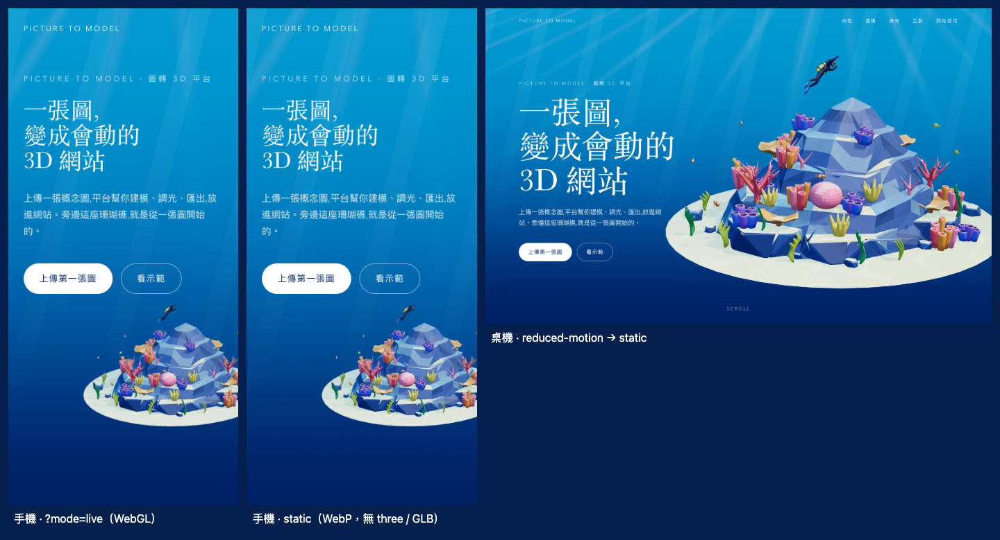

# Step 14 總結 — 手機靜態圖 fallback

對應 roadmap：[roadmap/14-mobile-fallback.md](../roadmap/14-mobile-fallback.md)

狀態：完成（2026-10-21）。

## 代表結果



左：同一支手機強制 `?mode=live` 的 WebGL 畫面；中：預設的 static 模式，一張 WebP，沒有下載 three、GSAP 與 GLB；
右：桌機開啟 reduced-motion 後也改用橫式靜態圖。中與左逐像素比較，平均誤差 0.94 / 255。

```ts
// useRenderMode.ts：多個訊號依序判斷，寬度從不單獨決定。
if (signals.reducedMotion) return { mode: 'static', reason: 'reduced-motion' }
if (signals.saveData) return { mode: 'static', reason: 'save-data' }
if (!signals.webgl) return { mode: 'static', reason: 'no-webgl' }
const touch = (signals.coarsePointer && !signals.finePointer) || signals.touchPoints > 1
if (touch && Math.min(signals.width, signals.height) < 768) return { mode: 'static', reason: 'touch-small-screen' }
if (signals.cores <= 2 || signals.memory <= 2) return { mode: 'static', reason: 'low-end' }
```

## 這一步做了什麼

1. `useRenderMode.ts`：讀取 reduced-motion、Save-Data、WebGL 與 `MAX_TEXTURE_SIZE`、核心數、記憶體、DPR、視窗、`pointer: coarse` / `any-pointer: fine` 與 `maxTouchPoints`，純函式 `decideRenderMode` 回傳 `live | static` 與判斷原因。門檻集中在 `renderModeConfig`。`?mode=live|static` 可強制指定，供擷圖與測試使用。
2. `useThreeScene.ts` 改為動態 `import()` Scene 與 ScrollController；static 模式直接回報 ready，不建立任何 Three 物件，也不請求 GLB。
3. `App.vue` 在啟動時決定一次模式，寫到 `.site` 的 `data-mode` / `data-mode-reason`；static 時在固定的 `.stage` 內放 `FallbackStill.vue`。
4. `FallbackStill.vue` 用 `<picture>`：直式與橫式各一張構圖，`srcset` 提供 1x / 2x。CSS `object-fit: cover`，直式把礁體錨在底部，與 Hero 構圖一致。
5. `scripts/render-fallback.mjs` 用 Chrome 開 `?state=1&mode=live`，隱藏文案後擷取同一個 renderer 的 Hero 畫面，再以 canvas 編碼 WebP（品質 0.82），不需安裝 cwebp。
6. 捲動時以 CSS `animation-timeline: scroll()` 讓靜態圖緩慢放大到 1.12 倍，代替 3D 的鏡頭移動；reduced-motion 下不啟用。這是 roadmap 允許的「單張 Hero 靜態圖 + CSS 變換」做法。
7. `scripts/inspect-fallback.mjs` 以 Chrome 裝置模擬跑七種情境，記錄模式、3D 請求、傳輸量與靜態圖對 live 的像素差，輸出截圖、總覽圖與 `fallback-report.json`。

## 產出

| 檔案 | 內容 |
|---|---|
| [useRenderMode.ts](../web/src/composables/useRenderMode.ts) | 訊號讀取、`decideRenderMode`、門檻設定與 `?mode=` 覆寫 |
| [useThreeScene.ts](../web/src/composables/useThreeScene.ts) · [App.vue](../web/src/App.vue) | 動態載入 Scene / ScrollController，`data-mode` 屬性 |
| [FallbackStill.vue](../web/src/components/FallbackStill.vue) · [landing.css](../web/src/landing.css) | `<picture>` + `srcset`、cover 定位與 CSS 捲動漂移 |
| [public/fallback/](../web/public/fallback/) | `hero-portrait(.webp / @2x)`、`hero-landscape(.webp / @2x)` 與 `manifest.json` |
| [render-fallback.mjs](../web/scripts/render-fallback.mjs) | 從 live renderer 擷取 Hero 並編碼 WebP（`bun run render:fallback`） |
| [inspect-fallback.mjs](../web/scripts/inspect-fallback.mjs) | 七種情境的證據（`bun run inspect:fallback`） |
| [fallback.spec.ts](../web/tests/fallback.spec.ts) | 判斷表、手機 static 無 3D 請求、桌機 live / reduced-motion / 覆寫 |
| [fallback-report.json](../web/screenshots/fallback-report.json) · [總覽圖](../web/screenshots/fallback-contact-sheet.png) · [手機](../web/screenshots/fallback-mobile.png) · [手機 CTA](../web/screenshots/fallback-mobile-cta.png) · [橫式](../web/screenshots/fallback-mobile-landscape.png) · [桌機 reduced-motion](../web/screenshots/fallback-desktop-reduced.png) | 量測與視覺證據 |

既有測試中原本靠 reduced-motion 固定畫面的三處改為 `?mode=live`，否則依新規則會拿到靜態圖。

## 技術說明

靜態圖（Chrome canvas WebP，品質 0.82）：

| 檔案 | 尺寸 | 大小 |
|---|---|---|
| hero-portrait.webp | 390×844 | 12.8 KB |
| hero-portrait@2x.webp | 780×1688 | 32.7 KB |
| hero-landscape.webp | 1440×900 | 55.3 KB |
| hero-landscape@2x.webp | 2880×1800 | 133.8 KB |

低面數、單一色票的畫面壓縮得很小，2x 直式圖只有 Roadmap 預估的三分之一。

情境（Chrome 155 裝置模擬，對 `vite preview` 的 production build，傳輸量為未壓縮大小）：

| 情境 | 模式 | 原因 | 請求 | 3D 請求 | 傳輸量 |
|---|---|---|---|---|---|
| 手機 390×844、觸控 | static | touch-small-screen | 6 | 0 | 219 KB |
| 手機 `?mode=live` | live | query | 11 | 4 | 1000 KB |
| 手機橫放 844×390 | static | touch-small-screen | 6 | 0 | 320 KB |
| 桌機 1440×900 + reduced-motion | static | reduced-motion | 6 | 0 | 241 KB |
| 桌機 1440×900 | live | capable | 11 | 4 | 1000 KB |
| 桌機視窗縮到 600 px | live | capable | 11 | 4 | 1000 KB |
| iPad Pro 11 | live | capable | 11 | 4 | 1000 KB |

static 頁的 219 KB 中有 156 KB 是上傳段落的概念圖 JPG，Three.js chunk（625 KB）、GSAP chunk（118 KB）、Scene chunk 與 640 KB 的 GLB 完全沒有請求；
production `index.html` 只 preload Vue runtime 那個 chunk。概念圖的延遲載入留給 Step 17。

| 驗證 | 結果 |
|---|---|
| Build | TypeScript 與 production build 通過，three / GSAP / Scene 各自成為動態 chunk |
| 瀏覽器測試 | 19 passed（新增 3 項，既有 16 項回歸） |
| 靜態圖 vs live | 同一 390×844 @2x 手機視窗，平均絕對誤差 0.94 / 255，差異超過 24 的像素 0.39% |
| 判斷表 | 窄桌機視窗、iPad 11 吋維持 live；iPad mini 尺寸、2 核、2 GB、無 WebGL、Save-Data、reduced-motion 為 static |
| 手機導覽 | 無 ScrollController 時原生錨點導覽可用，390 px 無橫向捲動，可捲到 CTA |

與 roadmap 的差異：靜態圖放在 `App.vue` 的固定 `.stage` 內（`FallbackStill.vue`），不是 `HeroSection.vue`，因為 live canvas 也在那一層，六段都要看得到礁體。
模式在啟動時決定一次；頁面開著時切換 reduced-motion 不會換模式，live 場景仍沿用 Step 11–12 的停用動態效果。
桌機 reduced-motion 使用橫式圖，手機橫放也是。

## Takeaway

- 用同一個 renderer 擷圖是對的：顏色、鏡頭、光線不用對，像素差小到可以當回歸基準。
- 「不只看寬度」要靠 `any-pointer: fine` 與 `maxTouchPoints` 區分窄視窗和觸控裝置，iPad 才不會誤判。
- 動態 `import()` 要連 ScrollController 一起拆，否則 GSAP 會跟著首屏進來。
- 下一步 [Step 15](15-offscreen-pause.md)：static 已經零 GPU；live 模式還需要離開畫面與分頁隱藏時暫停。
