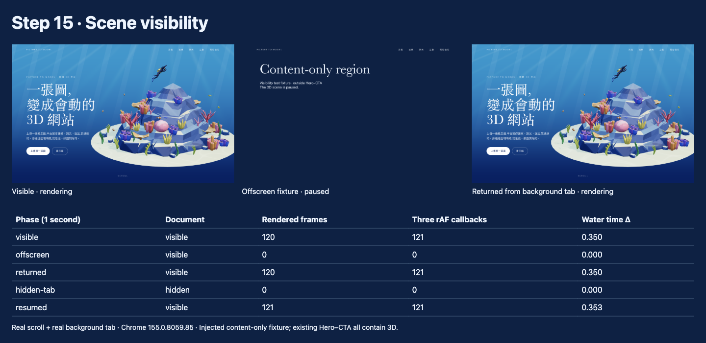

# Step 15 紀錄 — 離開畫面暫停 Render

對應 roadmap：[roadmap/15-offscreen-pause.md](../roadmap/15-offscreen-pause.md)

狀態：完成，2026-10-21。

驗證：TypeScript / production build 與全部 22 項 Playwright 測試通過；實際 Chrome trace 斷言通過。
Build 仍有既有共用 chunk 超過 500 kB 的提示，整體下載與效能驗收留給 Step 17。

## 代表結果



Chrome 155，1440 × 900，每個階段取樣約一秒；使用真正捲動與切換分頁。

| 階段 | document | 新增繪製幀數 | Trace 的 Three.js rAF 回呼 | 水光時間增加 |
|---|---|---:|---:|---:|
| Hero 可見 | visible | 120 | 121 | 0.350 |
| 離開所有 3D 區域 | visible | 0 | 0 | 0 |
| 捲回 Hero | visible | 120 | 121 | 0.350 |
| 背景分頁 | hidden | 0 | 0 | 0 |
| 切回分頁 | visible | 121 | 121 | 0.353 |

幀數快照與 trace 標記各自取樣，邊界可能相差一幀；這是生命週期驗證，不是跨裝置 FPS 基準。

## 這一步做了什麼

新增 `VisibilityController`，合併「有 3D 的區域可見」、「分頁可見」與「未手動暫停」三個條件。
任一條件不成立就停止 Scene 的 animation loop；全部成立才恢復，避免事件先後順序造成誤恢復。

固定滿版 canvas 始終在 viewport，因此觀察 App 裡六個標有 `data-has-3d` 的 `.story-step`。
wrapper 包含 sticky 停留距離。現有 Hero 到 CTA 都有 3D，footer 位於 CTA 內，停在 footer 時仍會繪製。
離屏驗證由腳本暫時插入不透明的純文字區域，正式版面沒有加入這段測試內容。

`Scene.pause()` 在停止後繪製最後一幀：採樣最新 section 狀態，但以 `delta=0` 保留水光與零件動畫時間。
`resume()` 清除時間基準，第一幀仍是 `delta=0`。重複暫停、載入前暫停及卸載後呼叫均不會重啟 loop。

## 產出

- [VisibilityController.ts](../web/src/three/VisibilityController.ts)：IntersectionObserver、分頁與手動控制、清理。
- [Scene.ts](../web/src/three/Scene.ts)：最後一幀、時間重設、初始化與卸載保護，以及繪製次數快照。
- [useThreeScene.ts](../web/src/composables/useThreeScene.ts)：掛載後建立控制器；失敗與卸載時清理。
- [visibility.spec.ts](../web/tests/visibility.spec.ts)：新增三項測試。
- [inspect-visibility.mjs](../web/scripts/inspect-visibility.mjs)：實際 Chrome 分頁切換、截圖、trace 與自動斷言。
- [量測報告](../web/screenshots/visibility-report.json)、[Chrome trace](../web/screenshots/visibility-trace.json.gz)、[畫面總覽](../web/screenshots/visibility-contact-sheet.png)。

重跑方式：

```bash
cd web
bun run build
PLAYWRIGHT_CHANNEL=chrome bun run test
bun run dev
# 另一個終端機；需要有桌面環境的 Chrome，預設使用 macOS 安裝路徑
bun run inspect:visibility
# 可用 VIEWER_URL 指定 dev server、CHROME_PATH 指定 Chrome 執行檔
```

trace 使用 gzip 儲存；解壓後可匯入 Chrome DevTools Performance，搜尋
`visible:start`、`offscreen:start`、`hidden-tab:start` 等 User Timing 標記。
對照 Three.js 的 `onAnimationFrame`：可見期間持續執行，暫停區間沒有回呼。

## 技術說明

- 控制器初始化時先量區域位置，避免等 IntersectionObserver 首次通知前誤啟動；隱藏時載入完成也不排程 render。
- Vue 的 `pause()` / `resume()` 控制獨立的手動條件；解除手動暫停仍須滿足可見性。
- 水光、指標阻尼與 PartAnimator 共用 Scene loop，暫停後都不持續更新。
- ScrollTrigger 保留事件驅動更新；目前沒有獨立的場景 GSAP idle 動畫，不停止全域 ticker。測試確認其他 GSAP tween 在本場景離屏時仍能運作。
- Static fallback 不建立 VisibilityController，也不載入 Three、GSAP 或 GLB。
- Playwright 測試使用合成 visibilitychange，覆蓋隱藏／離屏事件交錯、手動控制、背景載入、最後狀態同步、恢復首幀 `delta=0`、動畫凍結與清理。
- 實際分頁證據使用獨立暫存 Chrome profile，透過 `connectOverCDP({ noDefaults: true })` 連線，避免 Playwright 強制 focus 讓背景分頁仍呈現 visible。腳本結束後關閉該 Chrome 並刪除暫存 profile。
- 本步只控制 landing Scene；獨立 `/viewer.html` 仍保留原檢視工具生命週期。

## Takeaway

- fixed canvas 要用內容區域判斷可見性，不能只觀察 canvas。
- 暫停來源要合併判斷；停止 loop 與保留時間相位都需要驗證。
- 確認停止的是 Three.js 回呼，不應把整頁所有 rAF 都視為本場景的浪費。
- 下一步：[Step 16 — DPR 上限](16-dpr-limit.md)。
