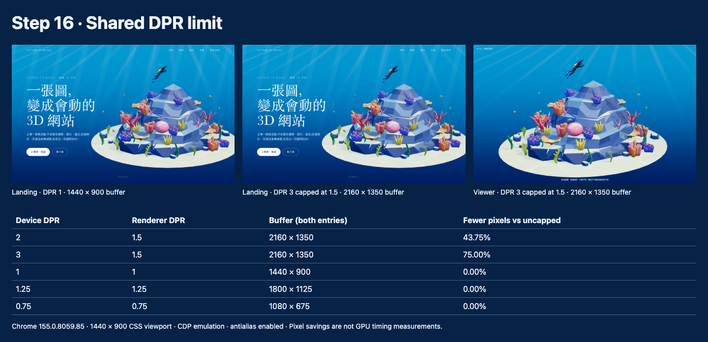

# Step 16 紀錄 — DPR 上限

對應 roadmap：[roadmap/16-dpr-limit.md](../roadmap/16-dpr-limit.md)

狀態：完成，2026-10-21。

驗證：TypeScript / production build、全部 25 項 Playwright 測試與 DPR 截圖腳本斷言通過。
Build 仍有既有共用 chunk 超過 500 kB 的提示，留給 Step 17 整體驗收。

## 代表結果



Chrome 155，固定 1440 × 900 CSS viewport，landing 與 viewer 得到相同結果：

| 裝置 DPR（模擬） | Renderer DPR | Canvas / WebGL drawing buffer | 相對未限制的像素減量 |
|---|---|---|---:|
| 2 | 1.5 | 2160 × 1350 | 43.75% |
| 3 | 1.5 | 2160 × 1350 | 75% |
| 1 | 1 | 1440 × 900 | 0% |
| 1.25 | 1.25 | 1800 × 1125 | 0% |
| 0.75 | 0.75 | 1080 × 675 | 0% |

```ts
export const rendererConfig = {
  maxPixelRatio: 1.5,
  antialias: true,
  powerPreference: 'default' as const,
}
```

像素減量由 buffer 面積計算，不等於實測 GPU 耗時或耗電下降比例。

## 這一步做了什麼

將初始化、landing resize、viewer resize 三處重複的 `1.5` 收斂到單一 config。
`getRendererPixelRatio()` 共用同一上限；antialias 保持開啟，powerPreference 明確保留既有 default。

除了既有 window resize 與 ResizeObserver，新增 resolution media query 監聽。
當 DPR 改變但 CSS viewport 尺寸不變時，仍會更新 buffer；每次變更後重新監聽新的 DPR，支援連續切換。
卸載時移除監聽，不增加每幀檢查或計時輪詢。

## 產出

- [config/renderer.ts](../web/src/three/config/renderer.ts)：共用上限、antialias 與 GPU 偏好。
- [rendererResolution.ts](../web/src/three/rendererResolution.ts)：取得有效 DPR、監聽 DPR 變動與清理。
- [createRenderer.ts](../web/src/three/createRenderer.ts)、[Scene.ts](../web/src/three/Scene.ts)、[Viewer.ts](../web/src/three/Viewer.ts)：初始化及尺寸變更時套用設定。
- [resolution.spec.ts](../web/tests/resolution.spec.ts)：新增三項瀏覽器測試。
- [inspect-resolution.mjs](../web/scripts/inspect-resolution.mjs)：可重跑的尺寸檢查、截圖與量測。
- [量測報告](../web/screenshots/resolution-report.json)、[畫面總覽](../web/screenshots/resolution-contact-sheet.png)。

```bash
cd web
bun run build
PLAYWRIGHT_CHANNEL=chrome bun run test
bun run dev
# 另一個終端機
bun run inspect:resolution
# VIEWER_URL 可指定其他 dev server port
```

## 技術說明

驗證範圍：

- 兩個入口在 DPR 2 初始化，確認限制為 1.5，且 WebGL antialias 為 true。
- 保持 CSS viewport 不變，依序切換 DPR 3 → 1 → 1.25 → 0.75 → 2；測試確認沒有 window resize 事件，buffer 仍隨 DPR 更新。
- DPR 3 時將 CSS viewport 改成 801 × 601，buffer 為 1201 × 901，依 Three.js 整數向下取整，不超過上限。
- 只改容器為 501 × 401，ResizeObserver 將 buffer 更新至 751 × 601。
- 初始暫停的 Scene 可更新 buffer，繪製幀數仍為 0；卸載與重複清理後不再響應 DPR 變更。
- 截圖腳本另核對 `canvas.width/height` 與 WebGL `drawingBufferWidth/Height` 一致；以 CSS 尺寸輸出截圖方便並排檢查。

這是 Chrome CDP 裝置模擬，未實際拖曳視窗跨實體螢幕。
CDP 單獨修改 deviceScaleFactor 不會通知既有媒體查詢，所以測試交替使用 screen / default media override 觸發瀏覽器重新評估；
沒有覆寫 devicePixelRatio getter，也沒有手動派送 resize 或 MediaQueryList change 事件。正式程式只監聽原生事件。

本步保留所有 live 裝置同一個 1.5 上限；手機／低效能裝置分流沿用 Step 14。
未加入選配的 FPS 自動降級，也沒有 EffectComposer 或 bloom 需要同步解析度。
DPR 設定只控制 WebGL buffer，HTML 文案與控制項仍由瀏覽器繪製。

## Takeaway

- 上限必須由初始化、resize 與兩個入口共用，才能避免設定漂移。
- DPR 改變不一定伴隨 CSS 尺寸變更；監聽 resolution，並在變更後重新綁定。
- 用實際 buffer 尺寸驗收，不能只看設定值或 CSS 大小。
- 下一步：[Step 17 — 效能 Audit](17-performance-audit.md)。
